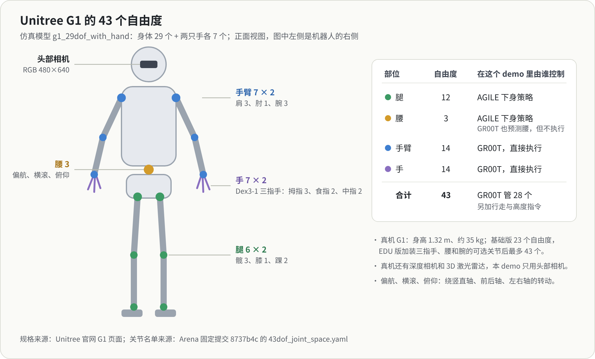
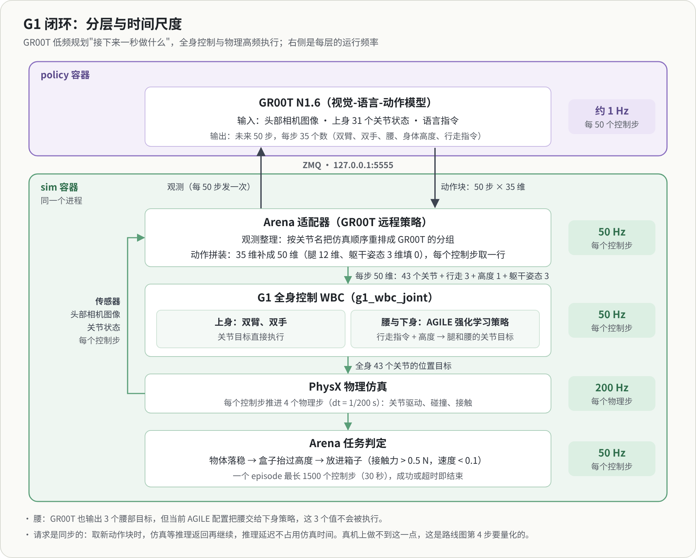

Robotics-lab 是我的具身智能个人研究项目：在仿真里搭一条完整的机器人管线，让机器人自己看、自己决定怎么动、自己完成任务。起点是复现 NVIDIA 的一个公开 demo：在 Isaac 仿真平台里，用 GR00T N1.6 大模型控制宇树 G1 人形机器人，完成一个仓库取放任务。为什么做这个项目、开发环境怎么搭、以后打算往哪走，写在[项目首页](/projects/robotics-lab/)。

这一篇先不碰代码，回答三个最基本的问题：这是什么机器人，它要完成什么任务，一次运行从头到尾经过哪些环节。后面的笔记都建立在这三点上。陌生的名词可以查末尾的名词表。

## 机器人：Unitree G1

G1 是宇树科技（Unitree）的人形机器人。官网给出的主要规格：

| 项 | 规格 |
|---|---|
| 身高、体重 | 约 1.32 m，约 35 kg（含电池） |
| 自由度 | 基础版 23 个；EDU 版 23–43 个，可选三指灵巧手 Dex3-1，以及腰、手腕的附加关节 |
| 灵巧手 Dex3-1 | 每只 7 个主动自由度：拇指 3、食指 2、中指 2 |
| 传感器 | 深度相机、3D 激光雷达 |
| 续航 | 约 2 小时 |

**自由度**是机器人能独立运动的方向数，对 G1 来说就是能独立驱动的关节数。仿真里用的是满配模型 `g1_29dof_with_hand`：身体 29 个自由度，加两只手各 7 个，一共 43 个。

| 部位 | 自由度 | 关节 |
|---|---|---|
| 腿 | 6 × 2 | 髋 3（俯仰、横滚、偏航）、膝 1、踝 2（俯仰、横滚） |
| 腰 | 3 | 偏航、横滚、俯仰 |
| 手臂 | 7 × 2 | 肩 3（俯仰、横滚、偏航）、肘 1、腕 3（横滚、俯仰、偏航） |
| 手 | 7 × 2 | 拇指 3、食指 2、中指 2 |

偏航、横滚、俯仰分别是绕竖直轴、前后轴、左右轴的转动。

在这个 demo 里，机器人只靠两类信息感知世界：头部的一个 RGB 相机（480×640 像素），以及自身 43 个关节的角度，后者叫**本体感知**。真机上的深度相机和激光雷达没有用到。

## 任务：从货架取盒子，放进箱子

场景是一个仿真仓库：仓库里有一个货架，上面放着一个棕色盒子；货架右侧有一张桌子，桌上有一个蓝色的分拣箱。机器人收到一句英文指令：

> Pick up the brown box from the shelf, and place it into the blue bin on the table located at the right of the shelf.

它要自己看、自己决定怎么动：从货架上取下盒子，走到桌边，把盒子放进箱子。这类边走边操作的任务叫**移动操作**（loco-manipulation）。它比站着操作难，是因为走路和手上的动作会互相影响：端着盒子迈步，重心和手臂的受力都在变，手要稳，脚下也不能失去平衡。

一次尝试叫一个 **episode**，最长 30 秒仿真时间。成功要依次满足三个条件：

1. 物体落稳（仿真开始时物体先稳定下来）；
2. 盒子被抬过一定高度；
3. 盒子稳稳待在箱子里：和箱子之间有大于 0.5 N 的接触力，并且几乎不再运动。

30 秒内没做到就算超时失败。

## 一次 episode 从头到尾

参与的有两个容器：policy 容器里运行 GR00T 大模型，sim 容器里运行仿真、控制器和评估程序。运行时两者只通过本机的一个网络端口交流（容器的分工见项目首页的[开发环境](/projects/robotics-lab/#开发环境)）。

1. **启动**：先在 policy 容器启动 GR00T 推理服务，它在本机的 5555 端口等待请求；再在 sim 容器启动评估程序，连上推理服务。
2. **重置**：Isaac Sim 搭好仓库、货架、盒子、箱子和 G1，机器人站在起点。
3. **每个控制步**（1/50 秒）重复下面几件事：
   1. 采集观测：头部相机拍一张图，读出 43 个关节的角度。
   2. 需要时向大模型要动作：手上的动作用完了（每 50 步一次，也就是每秒一次），就把图像、上身关节状态和那句指令发给 GR00T，拿回接下来 50 步的动作。
   3. 取出这一步的动作，交给全身控制器（WBC）：手臂和手的目标直接执行；腰和腿交给一个用强化学习训练好的小网络（AGILE），它根据"往哪走、走多快、身体多高"的指令生成迈腿和保持平衡的动作。
   4. 物理仿真推进 4 个物理步（每步 1/200 秒），算出碰撞、接触和关节运动。
   5. 检查任务条件有没有满足。
4. **结束**：三个条件都满足就成功；到 1500 个控制步（30 秒）还没完成就超时。
5. **记录**：结果写成一份 JSON 记录和一份 HTML 报告。

## 为什么要分层

| 层 | 频率 | 做什么 | 在哪个容器 |
|---|---|---|---|
| GR00T | 约 1 Hz | 看图像、读状态和指令，给出接下来 1 秒的动作 | policy |
| 适配器 | 50 Hz | 整理观测，把模型输出整理成控制器要的格式 | sim |
| 全身控制器 | 50 Hz | 手臂和手直接执行；腰和腿由 AGILE 生成，保持平衡 | sim |
| 物理仿真 | 200 Hz | 碰撞、接触、关节动力学 | sim |
| 任务判定 | 50 Hz | 检查三个成功条件 | sim |

大模型通用但慢，适合低频地想好"接下来一秒做什么"；平衡和步态要求快速反应，交给高频的小网络；物理计算更快、更细。这种"慢规划、快反射"是理解整个 demo 的主线。

## GR00T 看什么、输出什么

GR00T 是一个**视觉-语言-动作模型**（VLA）：输入图像和语言，输出机器人动作。

- **输入**：当前这一帧头部画面；上身 31 个关节的角度（左右臂各 7、左右手各 7、腰 3）；那句语言指令。腿的状态不给它看。
- **输出**：未来 50 步的动作，每步 35 个数：左右臂、左右手、腰的关节目标（31 个），身体高度（1 个），以及行走指令（3 个：前后速度、左右速度、转向角速度）。

控制器要的是每步 50 个数（43 个关节 + 行走 3 + 高度 1 + 躯干姿态 3），所以中间有一个适配器把 35 补成 50：腿的 12 个关节和躯干姿态的 3 个数填 0。腿本来就由 AGILE 负责，不需要 GR00T 给目标。有意思的是腰：GR00T 也会预测腰的 3 个目标，但当前的控制器配置把腰划给了下身策略，所以这 3 个值实际上不会被执行。

另一个细节是关节的编号。同一个关节在仿真和 GR00T 里的顺序不一样：仿真按左右交替、从躯干往外排，GR00T 按身体部位分组。适配器每次都按关节名字把数据重排一遍。

还有一点：在仿真评估里，向 GR00T 要动作是**同步**的。需要新动作块时，仿真会停下来等推理返回，所以推理花多长时间都不占用仿真时间。真机上做不到这一点，世界不会等模型想完。

## 动手：读两次评估记录

在本机跑过两次完整的无界面评估，结果在 `output/runs/arena-g1/evaluation/` 下，每次一个目录，里面有 HTML 报告和一份 `episode_results_rank0.jsonl`。记录里的 `events` 列出每个成功条件在第几步满足：

| | 物体落稳 | 盒子抬起 | 放进箱子 | 结果 |
|---|---|---|---|---|
| 第一次 | 第 1 步 | 第 75 步 | 未完成 | 1500 步超时，失败 |
| 第二次 | 第 1 步 | 第 136 步 | 第 979 步 | 成功 |

成功那次用了 979 个控制步，约 19.6 秒仿真时间，GR00T 大约推理了 20 次（每 50 步一次）。失败那次很早就把盒子抬了起来，说明感知、抓取和全身控制这几环都是正常的，问题出在后半段：走到桌边、对准箱子、放下。

## 还没搞懂

两次运行的随机种子都是 42，结果却一成一败。可能的来源有几个：GR00T 的动作头是从随机噪声开始逐步生成动作的，推理服务那边的随机数是否跟着种子固定，我还没核实；GPU 上的计算本身也不完全确定；物理仿真的细小数值差异会被几百步的闭环放大。不管是哪一个，结论都一样：跑一两次不能代表成功率，要有统计意义，得在固定条件下跑很多次。

## 名词表

| 名词 | 意思 |
|---|---|
| 自由度（DoF） | 能独立运动的方向数；对 G1 来说就是能独立驱动的关节数 |
| 本体感知 | 机器人对自身状态的感知，例如关节角度 |
| Isaac Sim | NVIDIA 的机器人仿真软件，负责物理计算和画面渲染 |
| Isaac Lab / Arena | Isaac Lab 是建在 Isaac Sim 上的机器人学习框架；Isaac Lab-Arena 在它之上定义任务、批量评估策略，这个 demo 就出自 Arena |
| GR00T N1.6 | NVIDIA 发布的人形机器人通用 VLA 模型，权重公开 |
| VLA | 视觉-语言-动作模型：输入图像和语言，输出机器人动作 |
| 动作块 | 模型一次输出的一段连续动作，这里是 50 步，覆盖 1 秒 |
| WBC | 全身控制器：把高层指令变成全身关节的目标，同时保持平衡 |
| AGILE | 这个 demo 里负责腰和腿的强化学习策略，根据行走指令和身体高度生成关节目标 |
| 控制步 / 物理步 | 控制器每 1/50 秒更新一次动作；物理仿真每 1/200 秒算一步，一个控制步包含 4 个物理步 |
| episode | 从重置到成功或超时的一次完整尝试 |
| 仿真时间 | 仿真世界里的时间，可以比真实时间快或慢 |
| 容器 | 打包好的独立运行环境（这里用 Docker）；项目分成 dev、sim、policy 三个 |
| ZMQ | 一种轻量的进程间通信库，sim 通过它向 policy 请求动作 |

## 来源

- Unitree G1 规格：Unitree 官网 G1 页面。
- 关节名单与顺序：Isaac Lab-Arena 提交 `8737b4c` 的 `isaaclab_arena_gr00t/embodiments/g1/43dof_joint_space.yaml`。
- 相机、场景、频率与成功条件：同一提交的 `isaaclab_arena/embodiments/g1/g1.py`、`isaaclab_arena_environments/galileo_g1_locomanip_pick_and_place_environment.py` 与任务判定代码。
