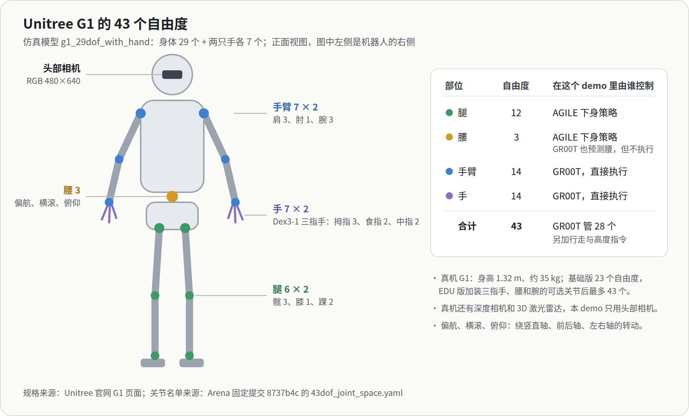
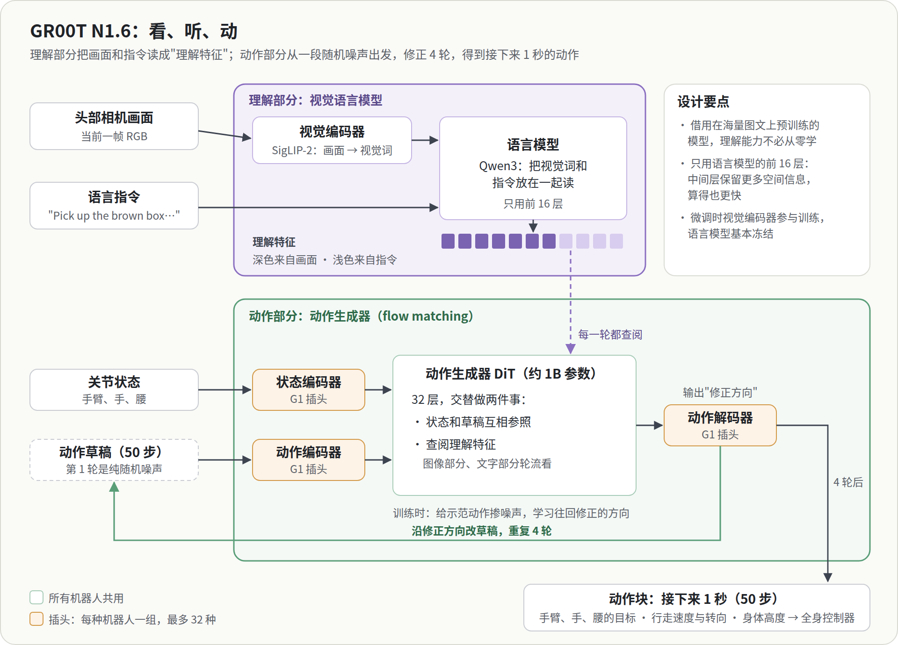
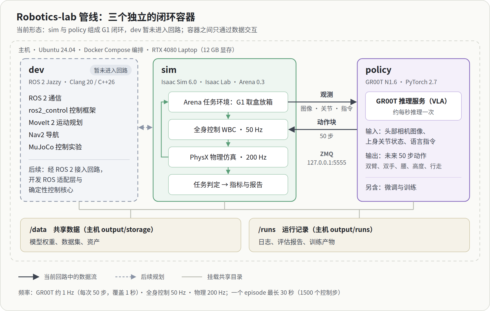
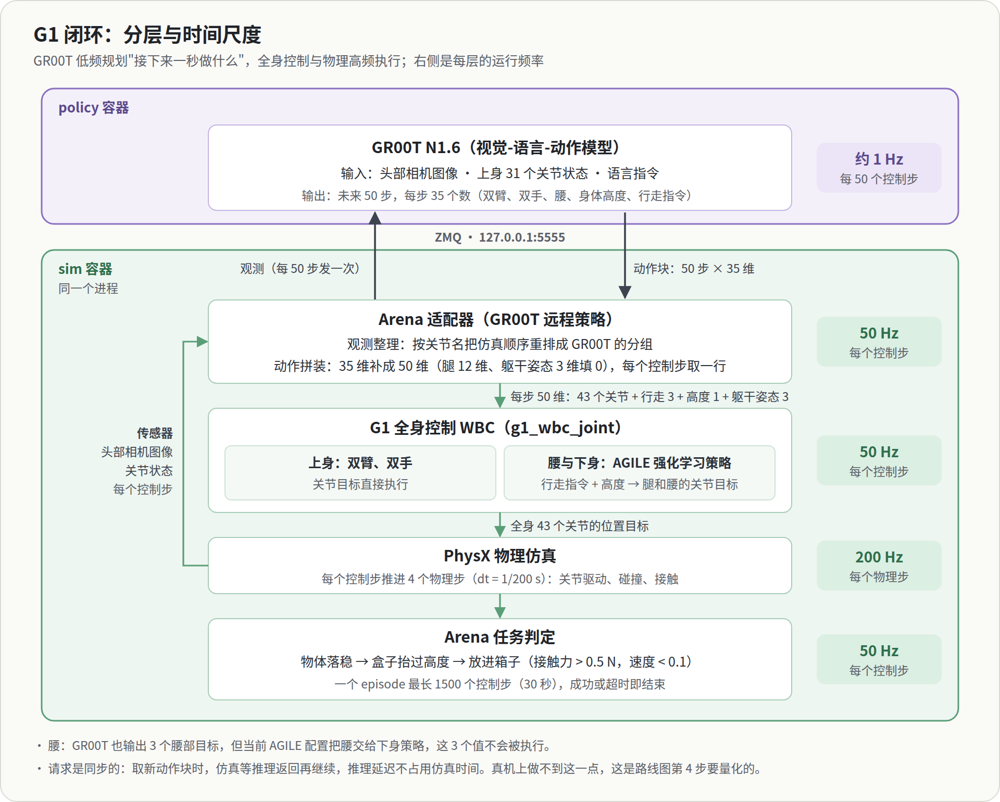

robotics-lab 是一个长期的具身智能项目。它的实验平台是 NVIDIA 于 2026 年 7 月开源的 Isaac Lab-Arena × GR00T N1.6 G1 移动操作 demo：一台仿真里的宇树 G1 人形机器人，听一句英文指令，从货架上取下盒子，走到桌边放进箱子。这个 demo 已经在一台 RTX 4080 笔记本（12 GB 显存）上跑通，8 次尝试成功 3 次。

平台只是起点。项目想把它逐步改造成一套模块化的机器人架构：AI 只负责决定"做什么"，物理安全和控制由确定性的部分保证；VLA 当作现成部件使用，不让它直接控制电机。这些还都是设想，细节见 [项目目标](https://github.com/chanc313/robotics-lab/blob/main/ws/docs/PROJECT_GOALS.md) 和 [项目计划](https://github.com/chanc313/robotics-lab/blob/main/ws/docs/PROJECT_PLAN.md)。

这一篇先把平台本身讲清楚，分七站：每站说它做什么、为什么这样设计，最后一段说它对后续开发意味着什么。不涉及公式，参数与代码位置在 [操作手册](https://github.com/chanc313/robotics-lab/blob/main/ws/docs/platform/G1_MANUAL.md) 里。

1. [整体分工](#一整体分工)
2. [VLA 怎么看和想](#二vla-怎么看和想)
3. [VLA 怎么动](#三vla-怎么动)
4. [小脑：全身控制与 AGILE](#四小脑全身控制与-agile)
5. [世界与考场：Isaac 三层](#五世界与考场isaac-三层)
6. [数据和训练从哪来](#六数据和训练从哪来)
7. [一秒钟里发生了什么](#七一秒钟里发生了什么)

## 一、整体分工

### 机器人：Unitree G1

G1 是宇树科技（Unitree）的人形机器人。官网给出的主要规格：

| 项 | 规格 |
|---|---|
| 身高、体重 | 约 1.32 m，约 35 kg（含电池） |
| 自由度 | 基础版 23 个；EDU 版 23–43 个，可选三指灵巧手 Dex3-1，以及腰、手腕的附加关节 |
| 灵巧手 Dex3-1 | 每只 7 个主动自由度：拇指 3、食指 2、中指 2 |
| 传感器 | 深度相机、3D 激光雷达 |
| 续航 | 约 2 小时 |

仿真里用的是满配模型：身体 29 个自由度，加两只手各 7 个，共 43 个。

| 部位 | 自由度 | 关节 |
|---|---|---|
| 腿 | 6 × 2 | 髋 3（俯仰、横滚、偏航）、膝 1、踝 2（俯仰、横滚） |
| 腰 | 3 | 偏航、横滚、俯仰 |
| 手臂 | 7 × 2 | 肩 3（俯仰、横滚、偏航）、肘 1、腕 3（横滚、俯仰、偏航） |
| 手 | 7 × 2 | 拇指 3、食指 2、中指 2 |

平台里机器人只用两类信息感知世界：头部的一个 RGB 相机，以及自身关节的角度。真机上的深度相机和激光雷达没有用到。

### 任务：从货架取盒子，放进箱子

仿真仓库里，货架上放着一个棕色盒子，货架右侧的桌上有一个蓝色分拣箱。机器人收到一句英文指令：

> Pick up the brown box from the shelf, and place it into the blue bin on the table located at the right of the shelf.

它要自己看、自己走、自己拿，整个过程没有手写的动作脚本。这类边走边操作的任务叫移动操作（loco-manipulation），难点在于走路和手上的动作会互相影响。一次尝试称为一个 episode，最长 30 秒仿真时间；物体落稳、盒子被抬起、盒子稳稳待在箱子里三步都完成才算成功，盒子中途掉落则提前结束。

### 三个角色

人去拿东西时，"去拿那个盒子"是一个慢的、有意识的念头；走路时脚怎么落地、身体怎么保持平衡，则是快的、几乎不用想的反应。平台按同样的思路分工：

| 角色 | 部件 | 多久做一次决定 | 负责什么 | 怎么学会的 |
|---|---|---|---|---|
| 大脑 | GR00T N1.6（VLA 模型） | 每秒 1 次 | 看图、听指令，决定接下来一秒手怎么动、往哪走 | 模仿人类示范 |
| 小脑 | 全身控制器，其中腿由 AGILE 负责 | 每秒 50 次 | 手臂和手照大脑给的目标去做；把"往前走、蹲低一点"变成迈腿的动作，并且不摔倒 | AGILE 在仿真里反复试错（强化学习） |
| 世界 | Isaac Sim | 每秒 200 次 | 计算碰撞、受力和运动，渲染相机画面 | 不学习，是物理引擎 |

为什么这样分？大模型懂图像和语言，但又大又慢；保持平衡要反应快，却不需要懂语言。各用所长，中间的接口很窄：大脑只告诉腿三件事，走多快、往哪转、身体多高。

**对二次开发**：这条窄接口，加上"手臂目标直接交给关节"这一段，正是以后插入确定性层的位置。1、50、200 次每秒这三档节奏也是整个架构的骨架，将来模块化时，进程边界大体就按这三档来划。

## 二、VLA 怎么看和想

### 基本思路

VLA 是视觉（Vision）、语言（Language）、动作（Action）的缩写。它的出发点是借力：互联网上的海量图文数据已经训练出能"看懂图、读懂话"的视觉语言模型（VLM）。VLA 在这样一个模型后面接上一个动作生成器，再用机器人示范数据教它把"理解"变成"动作"。理解能力不必从零学，机器人数据只需要教会它怎么动。GR00T 就是这样分成理解和动作两部分。

### 理解部分

- **看**：视觉编码器（SigLIP-2）把头部相机画面切成许多小块，每块变成一个向量，可以理解成一个个"视觉词"。
- **读**：语言模型（Qwen3）把视觉词和指令的文字放在一起读，输出一串"理解特征"：画面里有什么、指令要什么、两者怎样对应。
- **只用前半截**：语言模型后面的层被直接丢掉。语言模型最后几层专门为"说出下一个字"服务；中间层保留着更多空间和物体的信息，对动作更有用，算得也更快。
- **微调时动得很少**：针对这个任务微调时，语言模型基本冻结，所以它对语言的理解几乎全部来自预训练。

### 它看到的世界很窄

- 只看**当前一帧**头部画面，没有历史帧，不知道一秒前发生了什么。
- 画面会先缩小到大约 256 像素见方再送进模型。
- 没有深度，也没有腕部相机。
- 身体状态只给上身（手臂、手、腰），不给腿；腿怎么样，它并不知道。

**对二次开发**：VLA 的"眼界"很窄，确定性层需要的信息（物体位姿、接触、重心、是否打滑）不能指望从 VLA 里拿，要由自己的感知和状态估计提供。另外，模型是针对这个相机视角微调的，改变它的输入（换视角、加相机、加深度）都需要重新微调，这也是项目里定下"不改 VLA 的输入、只用现成的 VLA"这条边界的原因。

## 三、VLA 怎么动

### 从噪声里"画"出动作

动作生成器是一个约 1B 参数的 Transformer（论文里叫 DiT，扩散 Transformer）。它不是一步"算出"动作，而是：

1. 先随机生成一段"动作草稿"（纯噪声），长度是接下来 1 秒的 50 个控制步；
2. 每一轮，模型看着草稿和机器人自己的关节状态，并反复查阅理解特征（图像部分和文字部分轮流看），判断"草稿应该往哪个方向改"；
3. 按这个方向修改草稿，重复 4 轮，得到最终的动作块。

这和 AI 画图从一片噪点逐渐变清晰是同一个原理。训练方法叫 flow matching：拿一段真实的示范动作，掺进不同比例的噪声，让模型学会"往回修正的方向"。

### 三个设计选择

- **为什么从噪声生成，而不是直接输出一个答案？** 同一个场景常常有好几种正确做法，比如从左边绕过去或从右边绕过去。直接输出一个答案的模型会把它们平均成一个哪边都不是的错误动作；生成式模型能挑出其中一种，完整而连贯地做下去。
- **为什么一次输出一整秒？** 动作更连贯，大模型也不必每 1/50 秒算一次。代价是这一秒里它不再看新的画面，相当于闭着眼睛执行。
- **为什么要"插头"？** 不同机器人的关节数量和含义都不一样。读入关节状态和输出动作这两头，每种机器人各用一组小网络；中间的理解部分和动作生成器所有机器人共用。模型预留了 32 个插槽，这个任务用的是"新机器人"插槽。

### 它输出什么

每一步动作包括：两条手臂各 7 个、两只手各 7 个、腰 3 个关节的**目标角度**，加上行走速度（前后、左右、转向）和身体高度。一个动作块是 50 步这样的动作。

每次推理都从一段新的随机噪声出发，所以同样的场景跑两次，动作也会略有不同，结果不能完全复现。

**对二次开发**：动作块就是 VLA 对外的"合同"：一次给 1 秒、50 步、关节级的目标。项目定下的另一条边界"VLA 不直接控制电机"要改的是这份合同的**内容**，从关节目标改成手腕位姿这样的任务层意图；"控制回路不等 AI"要改的是合同的**时序**，即什么时候请求新动作、新旧两块怎么衔接。输出带随机性，意味着任何改进都必须靠多次评估的统计来证明。

## 四、小脑：全身控制与 AGILE

### 拿到一步动作之后

全身控制器每 1/50 秒拿到动作块里的一步，把它拆成两份：

- **手臂和手的目标**直接交给关节的 PD 控制器。PD 控制器像一根弹簧加一个阻尼器，把关节拉向目标角度。这里没有任何检查，大脑给什么，关节就去追什么。
- **行走速度和身体高度**交给 AGILE。

### AGILE 是什么

- **输入**：行走指令，加上全身关节状态等本体感知；**输出**：12 个腿部关节的目标角度；每秒 50 次。
- **怎么练**：强化学习。在 Isaac Lab 里让大量机器人并行练习，按"跟上指令、不摔倒、动作平稳省力"打分，分数高的行为被强化。
- **老师和学生**：先训练一个能看到仿真里完整真值信息的"老师"，再训练一个只用真实机器人也拿得到的传感信息的"学生"去模仿老师。学生带有记忆（LSTM），能从最近一段历史里推测看不到的信息。实际运行的是学生。
- **腰被锁定**：AGILE 只管两条腿，GR00T 给出的腰部目标被丢弃。

### 两种节奏并存

腿是**每 1/50 秒闭环**的：AGILE 每一步都看身体状态，随时修正。手臂在一秒之内只是**跟踪既定目标**，不看画面；盒子在手里打滑，手臂最长要等到下一块动作才会"知道"。

AGILE 的做法其实接近项目设想中的稳定守护进程：它把手臂的动作当成扰动，只管保持平衡，不关心扰动来自哪里。不同的是，它没有前馈，也没有可以验证的安全边界。

### 平台里还有别的选择

- **Pink 逆运动学控制器**：输入是两只手腕的目标位姿，由它算出手臂关节角。采集示范数据时的遥操作就用它。
- **另一个行走策略 HOMIE**：可以替换 AGILE。

**对二次开发**：手腕位姿加确定性中间层的方案，可以直接从 Pink 逆运动学起步；稳定守护进程可以先包装 AGILE（加前馈、加审计），以后再考虑用基于模型的控制器替代。

## 五、世界与考场：Isaac 三层

### 三层软件

| 层 | 做什么 |
|---|---|
| Isaac Sim | 物理引擎加渲染器。相机画面是渲染出来的，模型"看到"的就是仿真画面 |
| Isaac Lab | 把机器人、场景和控制器组织成可以训练、可以采数据的"环境"。AGILE 的强化学习和示范扩增都在这一层 |
| Isaac Lab-Arena | 在 Lab 之上搭"考场"：把场景、机器人、任务拼装起来，批量评估并生成报告 |

### 环境由几个"管理器"组成

Isaac Lab 的环境由几类条目拼成，每一类由一个管理器负责。这个任务里它们是：

| 管理器 | 做什么 | 这个任务里有什么 |
|---|---|---|
| 事件 | 在特定时刻改变世界 | 每个 episode 开始时重置机器人姿态、盒子和箱子的位置、控制器状态 |
| 观测 | 决定策略能读到什么 | 关节角度与速度、手腕位姿、头部相机画面 |
| 动作 | 把策略输出交给机器人 | 全身控制器（每步 50 个数） |
| 结束条件 | 决定 episode 何时结束 | 超时、成功、盒子掉落 |
| 记录 | 统计指标 | 成功率、物体是否被移动、各步进度 |

这里没有奖励项，因为评估时不训练。

### Arena 的考场功能

- **分步打分**：成功条件拆成"落稳、抬起、放入"三步，每完成一步记一次进度，失败时也能看出卡在哪一步。
- **批量评估与报告**：同一设置跑很多个 episode，汇总成功率。
- **变化项**：可以改变光照、相机内外参、物体质量等条件，并做敏感性分析，看成功率对哪个因素最敏感。

GR00T 跑在单独的进程（policy 容器）里，通过网络端口和仿真通信，所以模型也可以放到云端 GPU 上。三个容器的分工见 [容器指南](https://github.com/chanc313/robotics-lab/blob/main/ws/docs/CONTAINERS.md)。

**对二次开发**：几乎所有改动都能以"加一个管理器条目"的方式接进来：推力是一个事件，稳定裕度是一个观测，摔倒是一个结束条件，预警时间是一个记录指标。上游里 G1 只有这一个任务，其他任务属于别的机器人（GR1、Franka 等）。要用"不同任务的成功率"作为优化标准，需要自己定义 G1 的任务变体（换物体、换位置、加扰动）；官方权重只针对这一个任务微调过，换任务大概率要重新采数据并微调。

## 六、数据和训练从哪来

### 两个网络，两条训练路线

- **GR00T：模仿学习。** 先由 NVIDIA 在大量真实机器人数据、人类视频和仿真数据上预训练出基础模型（按 GR00T 系列论文的说明），再用这个任务的示范微调。
- **AGILE：强化学习。** 在仿真里试错练出来，与 GR00T 的训练完全独立。

### 这个任务的示范数据流水线

1. **遥操作**：人戴 VR 头显，在仿真里操作 G1 完成任务（摇杆控制走路和下蹲，手柄控制双手），录下少量示范。
2. **标注**：把示范切成子任务，例如走过去、抓起、放下。
3. **扩增**：Isaac Lab Mimic 变换物体位置，并相应调整轨迹，自动生成更多示范（上游教程生成 100 条）。
4. **转换**：转成 LeRobot 格式（表格记录状态和动作，视频记录画面）。
5. **微调**：在多张 GPU 上微调 GR00T，语言模型基本冻结，视觉编码器、动作生成器和 G1 的插头参与训练。
6. **部署**：得到的权重由推理服务加载，供评估使用。

结论很简单：大部分"常识"来自预训练，任务本身只需要百条量级的示范；Mimic 让少量人工示范变成足够多的训练数据。

**对二次开发**：数据里本来就记录了手腕位姿，所以把 VLA 的输出改成手腕位姿不需要重新采数据，只需要重新微调。新任务变体可以复用同一条流水线；遥操作需要 VR 头显，也可以用 Mimic 从已有示范扩增。3B 模型的微调需要租用云端多卡 GPU。

## 七、一秒钟里发生了什么

把前面几站串起来，一个动作块从请求到用完是这样的：

1. **请求**：上一块动作用完了。拍一帧头部画面、读出上身关节角，连同指令打包，发给 GR00T。**这时仿真暂停等待。**
2. **推理**：GR00T 理解一次画面和指令，动作生成器修正 4 轮，返回 50 步的动作块。
3. **执行 50 步**，每步是 1/50 秒仿真时间：
   - 取出当前这一步；
   - 手臂和手的目标交给关节 PD，行走指令交给 AGILE，AGILE 看身体状态给出腿的目标；
   - 物理引擎推进 4 个小步；
   - 检查是否成功、盒子是否掉落、是否超时。
4. **用完**：50 步执行完，回到第 1 步，用新的画面再请求。

一个成功的 episode 大约 1000 步，也就是约 20 秒仿真时间、约 20 次推理。在本机，仿真大约以 0.15 倍实时的速度运行。

**时间的错觉**：推理期间仿真是暂停的，所以在仿真时间里，推理好像不花时间。真实世界不会暂停。

**对二次开发**：真机上推理需要时间（本机推理延迟尚未实测），机器人要么停下来等，要么一边执行旧动作一边计算新动作，这就是"控制回路不等 AI"要解决的问题。"一秒闭眼"意味着手里的盒子打滑时，手臂最长要等一秒才会反应，项目设想中的部件反射层正好补上这个缺口。

## 名词表

| 名词 | 意思 |
|---|---|
| 自由度（DoF） | 能独立运动的方向数；对 G1 来说就是能独立驱动的关节数 |
| 本体感知 | 机器人对自身状态的感知，例如关节角度 |
| VLA | 视觉-语言-动作模型：输入图像和语言，输出机器人动作 |
| 动作块 | 模型一次输出的一段连续动作，这里是 50 步，覆盖 1 秒 |
| WBC | 全身控制器：把高层指令变成全身关节的目标，同时保持平衡 |
| PD 控制 | 按"离目标多远"和"运动多快"给出力矩，把关节拉向目标 |
| 控制步 / 物理步 | 控制器每 1/50 秒更新一次动作；物理仿真每 1/200 秒算一步 |
| episode | 从重置到成功、失败或超时的一次完整尝试 |
| 遥操作 | 人通过 VR 等设备实时操控机器人，用来采集示范 |
| ZMQ | 一种轻量的进程间通信库，sim 通过它向 policy 发请求 |

## 想深入时的关键词

- VLA 整体：GR00T N1 论文（arXiv 2503.14734）；π0（Physical Intelligence，flow matching VLA 的代表作）；OpenVLA
- 视觉语言模型：SigLIP、Eagle
- 生成式动作：Diffusion Policy；Flow Matching / Rectified Flow
- 动作块：ACT（Action Chunking with Transformers）
- 人形行走的强化学习：teacher-student 蒸馏、Isaac Lab 运动控制
- 示范扩增：MimicGen

## 来源

- Unitree G1 规格：Unitree 官网 G1 页面。
- 结构与参数：Arena 固定提交 `8737b4c`、GR00T 固定提交 `e29d8fc` 的源码与权重配置，以及 Arena 的 G1 移动操作工作流文档；环境中的管理器条目来自本机运行日志。逐项出处见 [操作手册的细节索引](https://github.com/chanc313/robotics-lab/blob/main/ws/docs/platform/G1_MANUAL.md#细节索引)。
