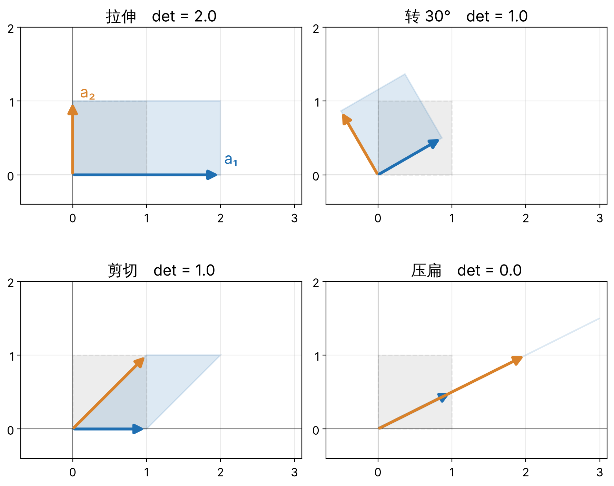
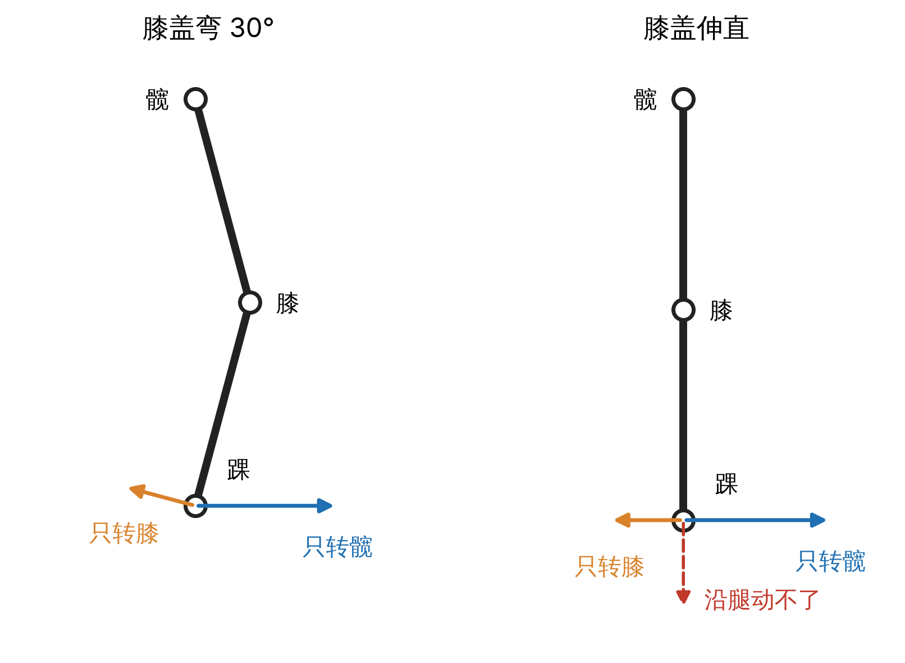

0.1 线性代数 · 单元 0-01 · 对照 Strang《Introduction to Linear Algebra》第 1–3 章，MIT 18.06（2010 春季）第 1、6、7、10 讲

本篇整理矩阵作为线性映射的基本概念：Ax 的两种读法、乘法与复合、列空间、秩与零空间、行列式，最后分析人形机器人腿伸直时的运动学奇异。

## 1 Ax 的两种读法

**线性映射**：T(αx + βy) = αT(x) + βT(y)。m×n 矩阵 A 定义了线性映射 ℝⁿ → ℝᵐ，x ↦ Ax。

- **按行**：(Ax)ᵢ 是 A 的第 i 行与 x 的点积。
- **按列**：Ax 是 A 的列的线性组合，系数为 x 的分量。

$$
A x = x_1 a_1 + x_2 a_2 + \cdots + x_n a_n
$$

A 的第 i 列 aᵢ = A eᵢ，即第 i 个坐标方向的像。线性映射由基向量的像唯一确定。

*2×2 矩阵把单位正方形映为以两列为边的平行四边形。下图依次为拉伸、转动、剪切与压扁；蓝色为第一列，橙色为第二列，灰色虚线为原正方形。*

## 2 乘法与复合

**矩阵乘法**：AB 对应复合映射 x ↦ A(Bx)，先作用 B，再作用 A。一般 AB ≠ BA。

*先转 30° 再沿 x 方向拉伸 2 倍，与先拉伸再转 30°，得到的平行四边形不同。*

*正运动学是一串变换的乘积（9-07、9-08）。*

## 3 列空间、秩与零空间

- **列空间** C(A)：{Ax : x ∈ ℝⁿ}，即列的全部线性组合。Ax = b 有解 ⇔ b ∈ C(A)。
- **秩** r：dim C(A)。
- **零空间** N(A)：{x : Ax = 0}。

**秩–零化度定理**：对 m×n 矩阵 A，

$$
n = r + \dim N(A)
$$

*平面 3R 臂的末端位置雅可比为 2×3。非奇异构型下 r = 2，dim N(J) = 1：零空间中的关节速度不改变末端位置，即自运动（[9-04](/theory/robot-kinematics-dynamics/9-04-constraints/)）。*

## 4 行列式与可逆

**行列式**：方阵 A 作用下有向面积（体积）的缩放因子；负号表示定向翻转。

对 n×n 矩阵 A，下列命题等价：

- det A = 0；
- A 的列线性相关，r < n；
- N(A) ≠ {0}；
- A 不可逆。

*"压扁"矩阵 [[1, 2], [0.5, 1]]：第二列是第一列的 2 倍，det = 0，平面被映到一条直线上。*

数值求解 Ax = b 不显式计算 A⁻¹，而用 LU 分解直接求解（`numpy.linalg.solve`）。

## 5 机器人问题：腿伸直时的奇异

### 5.1 模型

矢状面内的腿建模为平面 2R 链：髋关节角 q₁（大腿与竖直向下方向的夹角，向前为正），膝关节屈曲角 q₂（伸直为 0），大腿、小腿长 l₁ = l₂ = 0.4 m。以髋为原点，x 向前，z 向上，踝的位置为

$$
p(q) = l_1 \begin{bmatrix}\sin q_1\\ -\cos q_1\end{bmatrix} + l_2 \begin{bmatrix}\sin(q_1 - q_2)\\ -\cos(q_1 - q_2)\end{bmatrix}
$$

**雅可比**：J(q) = ∂p/∂q，ṗ = J(q) q̇ = q̇₁ J₁ + q̇₂ J₂。

- J₁：q̇ = (1, 0) 时踝的速度，垂直于髋–踝连线，大小为髋–踝距离；
- J₂：q̇ = (0, 1) 时踝的速度，垂直于小腿，大小为 l₂。

det J = l₁ l₂ sin q₂，即 J₁、J₂ 张成的平行四边形的有向面积。

### 5.2 伸直构型

q₂ = 0 时髋–踝连线与小腿重合，J₁ ∥ J₂：

- r = 1，C(J) 为垂直于腿的直线：踝沿腿方向的一阶速度为零；
- det J = 0；
- N(J) = span{(l₂, l₁ + l₂)}，等长时为 (1, 2)。

脚着地时，上述相对运动等价于骨盆相对支撑脚的运动：伸直的支撑腿在该瞬时不能使骨盆沿腿方向运动。

### 5.3 接近伸直的构型

取踝位于髋正下方的构型 q₁ = q₂/2，要求踝以 v = 0.1 m/s 向髋靠近，解 J q̇ = (0, v)：

| 膝屈曲角 | det J（m²） | 髋角速度 | 膝角速度 |
|---|---|---|---|
| 60° | 0.139 | 14°/s | 29°/s |
| 30° | 0.080 | 28°/s | 55°/s |
| 10° | 0.028 | 82°/s | 164°/s |
| 2° | 0.0056 | 410°/s | 821°/s |

该构型下 J₁ 水平，沿腿方向的速度分量仅来自 J₂，大小为 l₂ sin(q₂/2)，故所需膝角速度为 v / (l₂ sin(q₂/2))。

*基于 ZMP 的步行控制器通常使膝关节保持一定屈曲，原因之一是避开该奇异。6-01 的线性倒立摆假设质心高度不变，行走中髋–踝距离须持续变化，膝关节接近伸直时无法实现。*

### 5.4 线性化在奇异处的局限

从伸直构型沿零空间方向取有限步长 q = (ε, 2ε)，代入 p(q) 得 p = (0, −2l cos ε)，踝沿腿方向位移 2l(1 − cos ε) ≈ l ε²。一阶项为零，二阶项非零；ε = 0.045 rad 时位移为 0.8 mm。

*8-03 的阻尼最小二乘用于处理奇异附近的步长问题。*

## 小结

- m×n 矩阵定义线性映射 ℝⁿ → ℝᵐ；第 i 列是第 i 个坐标方向的像。
- 矩阵乘法对应映射复合，一般不可交换。
- n = r + dim N(A)；Ax = b 有解 ⇔ b ∈ C(A)。
- 方阵 det A = 0 ⇔ 秩不满 ⇔ 零空间非平凡 ⇔ 不可逆。
- 平面 2R 腿的雅可比 det J = l₁l₂ sin q₂；伸直时两列平行，踝沿腿方向一阶不可动；接近伸直时所需膝角速度按 1/sin(q₂/2) 增长。

## 来源

- Gilbert Strang, *Introduction to Linear Algebra*，第 1–3 章（[作者的课程网站](https://math.mit.edu/~gs/linearalgebra/)）；MIT OCW [18.06 Linear Algebra（2010 春季）](https://ocw.mit.edu/courses/18-06-linear-algebra-spring-2010/)第 1、6、7、10 讲。
- 3Blue1Brown，[线性代数的本质](https://www.3blue1brown.com/topics/linear-algebra)（Essence of Linear Algebra）前 7 集。
- 5.3、5.4 节的数字：l₁ = l₂ = 0.4 m，q₁ = q₂/2，用 numpy 求解 J q̇ = (0, 0.1)；零空间步长取 (q₁, q₂) = (0.045, 0.089) rad。
