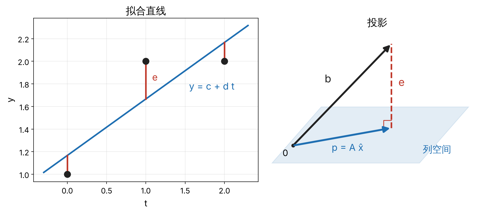

0.1 线性代数 · 单元 0-02 · 对照 Strang《Introduction to Linear Algebra》第 4 章，MIT 18.06（2010 春季）第 14–17 讲

本篇整理 Ax = b 无解时的处理方法：正交、投影、最小二乘与 QR 分解，最后用最小二乘标定 2R 臂的连杆长度。

## 1 正交与投影

**正交**：aᵀb = 0。

**向直线的投影**：b 在 span{a} 上的正交投影为

$$
p = a\,\frac{a^\top b}{a^\top a}
$$

误差 e = b − p 满足 aᵀe = 0。p 是 span{a} 中距 b 最近的点。

## 2 最小二乘

**最小二乘解**：x̂ = argmin_x ‖Ax − b‖²。

A x̂ 是 b 在 C(A) 上的正交投影，误差 b − A x̂ 与 C(A) 正交，即与 A 的每一列正交：

$$
A^\top (b - A\hat x) = 0 \quad\Longleftrightarrow\quad A^\top A\,\hat x = A^\top b
$$

后者称为**正规方程**。A 列满秩时 AᵀA 可逆，x̂ 唯一。

*过 (t, y) = (0, 1)、(1, 2)、(2, 2) 拟合 y = c + d t：A = [[1, 0], [1, 1], [1, 2]]，b = (1, 2, 2)。解得 c = 7/6，d = 1/2，e = (−1/6, 1/3, −1/6)，Aᵀe = 0。*

*左：数据空间，红线为各点误差。右：ℝ³ 中，p 为 b 在 C(A) 上的投影，e ⊥ C(A)。*

## 3 正交矩阵与 QR 分解

**正交矩阵**：方阵 Q，QᵀQ = I。保持向量长度与夹角。旋转矩阵是 det = +1 的正交矩阵（9-05）。

**QR 分解**：列线性无关的 A 可分解为 A = QR，Q 的列正交归一，R 为上三角矩阵。它是 Gram–Schmidt 正交化的矩阵形式。最小二乘问题化为 R x̂ = Qᵀb，回代求解。

**优势**：不构造 AᵀA。κ(AᵀA) = κ(A)²，正规方程对数据误差的放大程度是 QR 的平方量级（条件数见 0-05）。

**代价**：

- 行数远大于列数时，计算量约为解正规方程的两倍。

*`numpy.linalg.lstsq` 内部使用 SVD（0-05），同样不构造 AᵀA。*

## 4 机器人问题：标定连杆长度

### 4.1 问题

平面 2R 臂的标称连杆长度为 0.400 m、0.300 m，实际为 0.403 m、0.297 m。以标称长度计算的末端位置与动作捕捉测量值的均方根偏差为 4.3 mm，最大 7.7 mm。目标是由测量数据估计实际长度。

### 4.2 线性模型

关节角由编码器给出，视为已知。末端位置

$$
p = l_1 \begin{bmatrix}\cos\theta_1\\ \sin\theta_1\end{bmatrix} + l_2 \begin{bmatrix}\cos(\theta_1+\theta_2)\\ \sin(\theta_1+\theta_2)\end{bmatrix}
$$

关于关节角非线性，关于 (l₁, l₂) 线性。N 个位姿给出 2N 个方程：

- A ∈ ℝ^{2N×2}，第 k 个位姿对应两行 [[cos θ₁, cos(θ₁+θ₂)], [sin θ₁, sin(θ₁+θ₂)]]；
- b ∈ ℝ^{2N} 为测得的末端坐标。

### 4.3 结果

N = 20，θ₁ ∈ [−90°, 90°]、θ₂ ∈ [20°, 150°] 随机取值，测量噪声标准差 1 mm。最小二乘解 l̂₁ = 0.40277 m、l̂₂ = 0.29726 m，误差 −0.23 mm、+0.26 mm；Aᵀe 为舍入误差量级。

标定后模型与测量的均方根偏差为 1.5 mm，与二维测量噪声的理论值 1.4 mm 相当，残差主要来自测量噪声。

*实际标定还需估计关节零位偏差与基座位姿，这些参数以三角函数形式进入模型，属于非线性最小二乘（8-03）。*

### 4.4 失效一：离群值

将一个测量值的 x 坐标加 5 cm，l̂₂ 的误差由 0.26 mm 增至 2.66 mm。平方代价对大残差的权重过高，单个离群值即可显著改变解。

该坐标的残差为 48.9 mm，其余 39 个坐标均不超过 4.3 mm，可由残差检出；或改用鲁棒代价函数（14-04）。

### 4.5 失效二：激励不足

20 个位姿均为 θ₂ = 0 时，A 的两列相同，r = 1，AᵀA 奇异，只能辨识 l₁ + l₂。`lstsq` 返回最小范数解 (0.350, 0.350)，和为 0.700 m，分配不可辨识。

θ₂ ∈ [0°, 5°] 时两列接近平行，κ(A) 由 1.05 增至 33，估计误差约 5 mm，约为前者的 20 倍。标定位姿应使 A 的列远离线性相关。

*伸直的臂在 [0-01](/theory/linear-algebra/0-01-linear-maps/) 中对应运动学奇异，在此对应参数不可辨识，两者都源于两列平行。*

## 小结

- 点到子空间的最近点是正交投影，误差与子空间正交。
- 最小二乘解满足正规方程 AᵀA x̂ = Aᵀb。
- QR 与 SVD 不构造 AᵀA，数值上优于正规方程。
- 2R 臂的末端位置关于连杆长度线性，长度标定是线性最小二乘问题。
- 离群值显著影响解，需检查残差或使用鲁棒代价；位姿激励不足时参数不可辨识。

## 来源

- Gilbert Strang, *Introduction to Linear Algebra*，第 4 章（[作者的课程网站](https://math.mit.edu/~gs/linearalgebra/)）；MIT OCW [18.06 Linear Algebra（2010 春季）](https://ocw.mit.edu/courses/18-06-linear-algebra-spring-2010/)第 14–17 讲。
- 第 4 节的数字：真实长度 0.403 m、0.297 m，20 个随机位姿，测量噪声 1 mm，用 numpy 计算（随机种子 0）。
