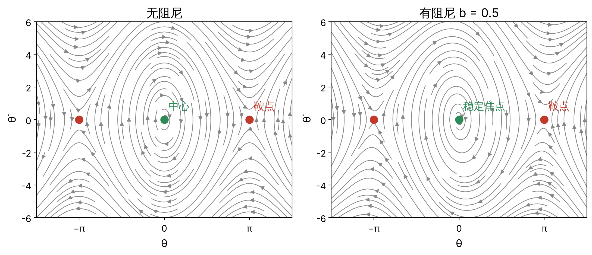
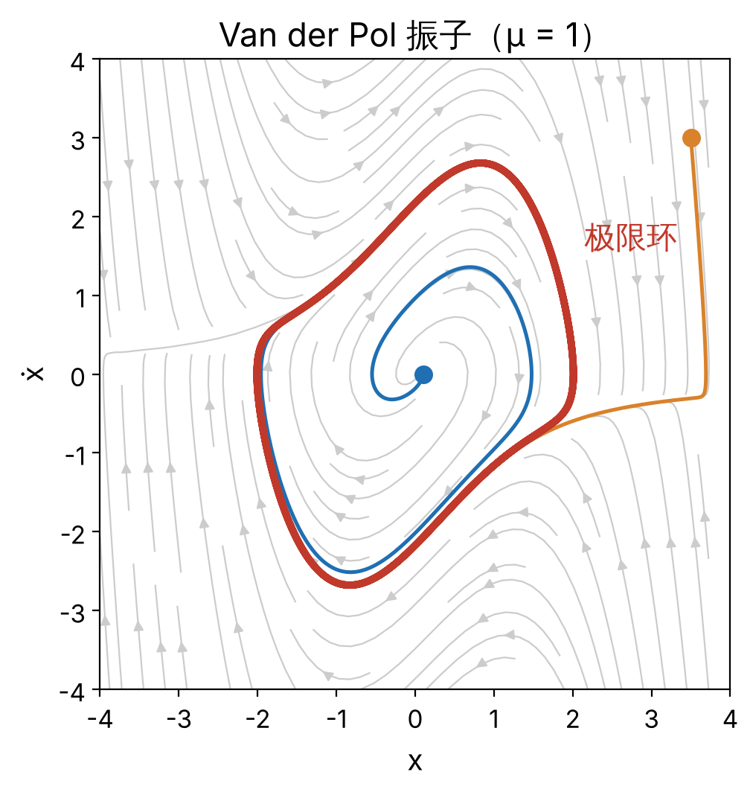
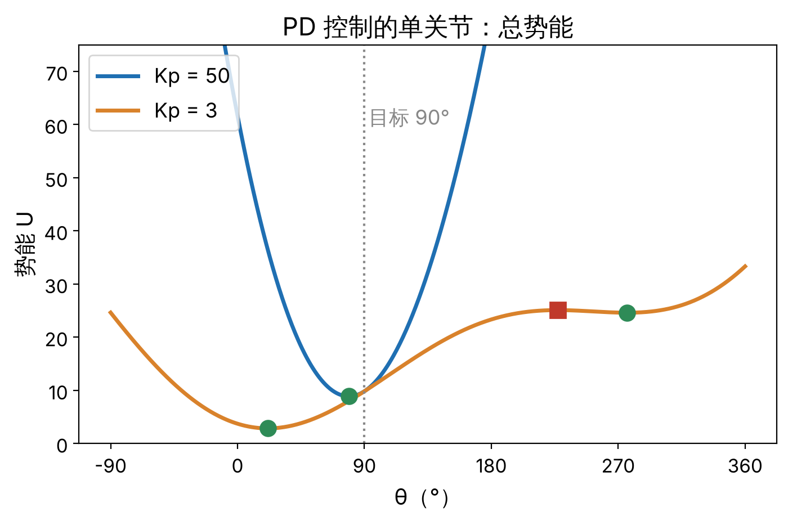

7.1 非线性系统的稳定性 · 单元 7-01 至 7-04 · 对照 Khalil《Nonlinear Systems》第 3 版 1.1–1.2、2.1–2.4、4.1–4.3、8.2–8.3

本篇整理非线性系统稳定性分析的基本概念与方法：状态空间与平衡点、稳定性定义、相图与极限环、线性化、李雅普诺夫直接法、LaSalle 不变原理、吸引域与全局稳定，最后分析单关节 PD 控制。

## 1 状态空间与平衡点

**状态**：一组最少的变量，给定它们在 t₀ 时刻的值和 t ≥ t₀ 的输入，即可唯一确定系统在 t ≥ t₀ 的行为。n 阶常微分方程有 n 个状态。

$$
\dot x = f(x, u), \qquad y = h(x, u)
$$

**机械系统的状态**：n 自由度机械系统的运动方程是二阶的，状态 x = (q, q̇) ∈ ℝ²ⁿ。

**自治系统**：ẋ = f(x)，f 不显含时间 t。输入为常数或状态反馈 u = k(x) 时，闭环系统是自治系统。

**平衡点**：满足 f(x*) = 0 的点 x*。

*单摆（m = l = 1，阻尼 b）：x = (θ, θ̇)，ẋ₁ = x₂，ẋ₂ = −b x₂ − g sin x₁。平衡点为 (kπ, 0)。*

线性系统 ẋ = Ax 的平衡点集合是 A 的零空间：A 可逆时只有原点，否则是一个子空间。非线性系统可以有多个孤立平衡点。下文均通过平移 z = x − x* 把平衡点置于原点。

## 2 稳定性的定义

稳定性是平衡点的性质。设原点是 ẋ = f(x) 的平衡点。

1. **吸引**：存在 r > 0，使 ‖x(0)‖ < r ⇒ lim_{t→∞} x(t) = 0。
2. **全局吸引**：对任意初值，lim_{t→∞} x(t) = 0。
3. **解有界**：对任意 a > 0，存在 β > 0，使 ‖x(0)‖ ≤ a ⇒ ‖x(t)‖ ≤ β，∀t ≥ 0。
4. **（李雅普诺夫）稳定**：对任意 ε > 0，存在 δ > 0，使 ‖x(0)‖ < δ ⇒ ‖x(t)‖ < ε，∀t ≥ 0。
5. **不稳定**：不满足 4。
6. **渐近稳定**：稳定且吸引。
7. **指数稳定**：存在 δ, α, β > 0，使 ‖x(0)‖ < δ ⇒ ‖x(t)‖ ≤ α‖x(0)‖e^(−βt)，∀t ≥ 0。
8. **全局渐近稳定**：稳定且全局吸引。
9. **全局指数稳定**：7 中的不等式对任意初值成立。

指数稳定 ⇒ 渐近稳定 ⇒ 稳定，逆命题均不成立。吸引不蕴含稳定（Vinograd 给出了吸引但不稳定的例子），因此渐近稳定的定义要求两者同时成立。

| 例子 | 结论 |
|---|---|
| 无阻尼单摆，θ = 0 | 稳定，非渐近稳定 |
| 有阻尼单摆，θ = 0 | 局部指数稳定，非全局 |
| 单摆，θ = π | 不稳定 |
| ẋ = −x³ | 全局渐近稳定，非指数稳定；x(t) = x₀ / √(1 + 2x₀²t) |

**线性系统**：ẋ = Ax 的原点渐近稳定 ⇔ A 的所有特征值实部为负；此时原点全局指数稳定。

## 3 相图与极限环

**相图**：二维自治系统在相平面上的轨迹族。轨迹在每一点与向量场 f(x) 相切；解唯一时轨迹互不相交。

*无阻尼单摆：θ = 0 为中心，θ = ±π 为鞍点。有阻尼单摆（θ̈ = −g sin θ − b θ̇）：0 < b < 2√g 时 θ = 0 为稳定焦点，b ≥ 2√g 时为稳定结点（b = 2√g 为退化结点）；θ = ±π 为鞍点。左图 b = 0.5。*

**极限环**：孤立的闭合轨道，即存在一个邻域，其中没有其他闭合轨道。

**中心与极限环的区别**：中心周围是连续的一族闭合轨道，振幅由初值决定；极限环是孤立的，振幅由系统决定。

**极限环的稳定性**：邻近轨迹趋于该闭合轨道，称轨道渐近稳定；只要求邻近轨迹不远离该轨道，称轨道稳定。两者都不要求趋于某一点。

*Van der Pol 振子 ẍ − μ(1 − x²)ẋ + x = 0（μ > 0）：|x| < 1 时等效阻尼为负，|x| > 1 时为正。0 < μ < 2 时原点为不稳定焦点，μ ≥ 2 时为不稳定结点；对任意 μ > 0 存在唯一的稳定极限环。图中 μ = 1。*

线性系统没有极限环：若 x(t) 是 ẋ = Ax 的闭合轨道，则 c·x(t) 对任意 c 也是闭合轨道，闭合轨道不孤立。

*在机器人中，周期步态常被设计为稳定的极限环；执行器饱和、静摩擦与间隙则可能在控制回路中引起不期望的极限环振荡。*

## 4 线性化判稳定

**李雅普诺夫间接法**：设 A = ∂f/∂x |ₓ*。

- A 的所有特征值实部 < 0 ⇒ x* 局部指数稳定；
- A 有实部 > 0 的特征值 ⇒ x* 不稳定；
- A 有实部 = 0 的特征值且其余实部 ≤ 0 ⇒ 无法判定。

**平衡点分类（二维）**：两负实根为稳定结点；异号实根为鞍点；实部为负的共轭复根为稳定焦点；纯虚根为中心。

**Hartman–Grobman 定理**：A 无实部为零的特征值（双曲平衡点）时，原系统在 x* 邻域内的相图与线性化系统的相图拓扑等价。中心不是双曲平衡点，线性化的结论不能推广到原系统。

*单摆 θ = 0：A = [[0, 1], [−g, −b]]。b = 0 时特征值 ±3.13j，无法判定；b = 0.5 时 −0.25 ± 3.12j，局部指数稳定。*

*ẋ = −x³：A = 0，无法判定，而原点全局渐近稳定。线性化有零实部特征值时，可确定的只有"非指数稳定"（f 连续可微且雅可比在原点附近 Lipschitz 时，指数稳定 ⇔ A 的特征值实部全为负）。*

## 5 李雅普诺夫直接法

**正定函数**：V(0) = 0，且在原点的邻域 D 内 x ≠ 0 时 V(x) > 0。

**V 沿轨迹的导数**：

$$
\dot V(x) = \frac{\partial V}{\partial x} f(x)
$$

**李雅普诺夫定理**：V 在 D 上连续可微且正定。

- V̇ ≤ 0（x ∈ D）⇒ 原点稳定；
- V̇ < 0（x ∈ D，x ≠ 0）⇒ 原点渐近稳定；
- 存在 k₁, k₂, k₃ > 0，使 k₁‖x‖² ≤ V ≤ k₂‖x‖²，V̇ ≤ −k₃‖x‖² ⇒ 原点指数稳定。

定理是充分条件。

### 5.1 机械能作为李雅普诺夫函数

系统 ẋ₁ = x₂，ẋ₂ = −φ(x₁) − ψ(x₂)，其中 x₁φ(x₁) > 0（x₁ ≠ 0），x₂ψ(x₂) ≥ 0。取

$$
V = \int_0^{x_1} \varphi(s)\,ds + \tfrac12 x_2^2
$$

则 V̇ = −x₂ψ(x₂) ≤ 0。φ 对应保守恢复力，ψ 对应耗散力，V 为机械能，V̇ 为耗散功率。n 自由度机械臂的对应形式为 V = ½q̇ᵀM(q)q̇ + U(q)，求导时利用 Ṁ − 2C 的斜对称性消去科氏力项。

*单摆：V = g(1 − cos x₁) + ½x₂²，V̇ = −b x₂² ≤ 0，原点稳定。V̇ 在 {x₂ = 0} 上恒为零，只是半负定，本定理不能给出渐近稳定。*

### 5.2 线性系统与李雅普诺夫方程

ẋ = Ax，V = xᵀPx，V̇ = xᵀ(AᵀP + PA)x。**李雅普诺夫方程**：

$$
A^\top P + P A = -Q, \qquad Q = Q^\top \succ 0
$$

A 的所有特征值实部为负 ⇔ 方程有唯一解 P = Pᵀ ≻ 0。第 4 节第一条的证明即以线性化 A 解出的 P 构造 V。

## 6 LaSalle 不变原理

**不变集**：M 称为（正）不变集，若 x(0) ∈ M ⇒ x(t) ∈ M，∀t ≥ 0。

**LaSalle 不变原理**：Ω 为紧的正不变集，V 连续可微且在 Ω 上 V̇ ≤ 0。记 E = {x ∈ Ω : V̇(x) = 0}，M 为 E 中最大的不变集。则从 Ω 出发的每条轨迹当 t → ∞ 时趋于 M。

**推论（Barbashin–Krasovskii）**：V 正定，V̇ ≤ 0，且除 x(t) ≡ 0 外没有解恒留在 {V̇ = 0} 中 ⇒ 原点渐近稳定。若 D = ℝⁿ 且 V 径向无界，则全局渐近稳定。

*有阻尼单摆：E = {x₂ = 0}。若解恒在 E 中，则 x₂ ≡ 0 ⇒ ẋ₂ ≡ 0 ⇒ sin x₁ = 0，在 |x₁| < π 内只有 x₁ = 0。原点渐近稳定。*

LaSalle 原理不要求 V 正定，M 可以是平衡点以外的不变集（如闭合轨道）。它适用于自治系统；时变系统（如轨迹跟踪）需用 Barbalat 引理。

## 7 吸引域与全局稳定

**吸引域**：{x₀ : 从 x₀ 出发的解趋于平衡点}。

**吸引域的估计**：取最大的 c，使 Ω_c = {V ≤ c} 中包含原点的连通分量有界且满足第 6 节的条件；该连通分量包含于吸引域。该估计一般是保守的。

*ẋ₁ = x₂，ẋ₂ = −x₁ + x₁³ − x₂，鞍点 (±1, 0)。V = ½x₁² − ¼x₁⁴ + ½x₂²，V̇ = −x₂²。V 在鞍点处取 ¼，{V < ¼} 中包含原点的连通分量是吸引域的一个估计。*

**径向无界**：‖x‖ → ∞ 时 V(x) → ∞。

**全局渐近稳定的条件**：李雅普诺夫定理（或 LaSalle 推论）的条件在 ℝⁿ 上成立，且 V 径向无界。缺少径向无界时，水平集可能无界，V 递减不能保证解有界。

*V = x₁²/(1 + x₁²) + x₂²：x₂ = 0、|x₁| → ∞ 时 V → 1，c ≥ 1 的水平集无界。*

存在多个平衡点的系统，任一平衡点都不是全局渐近稳定的。

## 8 机器人问题：不加重力补偿的单关节 PD 控制

### 8.1 模型与平衡点

单关节：质量 m 集中于杆端，杆长 l，θ 自竖直向下量起，τ 为电机施加的关节力矩（控制输入）。对象模型：

$$
m l^2\,\ddot\theta + m g l \sin\theta = \tau
$$

取 m = l = 1，目标 θ_d = 90°，控制律 τ = K_p(θ_d − θ) − K_d θ̇，K_d > 0。代入对象模型，闭环为：

$$
\ddot\theta = K_p(\theta_d - \theta) - K_d\,\dot\theta - g \sin\theta
$$

平衡点满足 K_p(θ_d − θ*) = g sin θ*。θ* ≠ θ_d，存在稳态误差。

| K_p | 平衡点 |
|---|---|
| 50 | 79.0°（稳定） |
| 20 | 64.6°（稳定） |
| 5 | 31.4°（稳定） |
| 3 | 21.5°（稳定）、227.0°（不稳定）、276.2°（稳定） |

### 8.2 线性化

A = [[0, 1], [−(K_p + g cos θ*), −K_d]]。K_d > 0 时，θ* 局部指数稳定 ⇔ K_p + g cos θ* > 0，否则为鞍点。

### 8.3 李雅普诺夫函数与 LaSalle

总势能 U(θ) = ½K_p(θ − θ_d)² + g(1 − cos θ)，V = ½θ̇² + U(θ)：

$$
\dot V = \dot\theta\,\big(\ddot\theta + U'(\theta)\big) = -K_d\,\dot\theta^2 \le 0
$$

V 径向无界，水平集紧。由 LaSalle 原理，所有解趋于 {θ̇ = 0} 中的最大不变集，即 U 的驻点集合（平衡点）。U 的严格极小点是稳定平衡点，极大点是不稳定平衡点。

### 8.4 全局渐近稳定的条件

U″(θ) = K_p + g cos θ ≥ K_p − g。**K_p > g**（一般形式 K_p > m g l）时 U 严格凸，平衡点唯一，由 8.3 得全局渐近稳定。

该条件是充分条件：K_p = 5 < g 时本例仍只有一个平衡点；K_p = 3 时有三个平衡点，收敛到哪一个取决于初值。

**重力补偿**：τ = K_p(θ_d − θ) − K_d θ̇ + g sin θ 抵消重力项，总势能变为 ½K_p(θ − θ_d)²，对任意 K_p > 0，θ_d 全局渐近稳定，且无稳态误差。

## 小结

- 稳定、渐近稳定、指数稳定是平衡点的性质，强度依次增加；全局版本要求对任意初值成立。吸引不蕴含稳定。
- 极限环是孤立的闭合轨道，仅存在于非线性系统。
- 线性化只给出局部结论；有零实部特征值时无法判定。
- 李雅普诺夫直接法：V 正定，V̇ ≤ 0 得稳定，V̇ < 0 得渐近稳定。机械能是机械系统的自然候选。
- V̇ 仅半负定时，用 LaSalle 不变原理证明渐近稳定。
- 全局结论要求 V 径向无界；存在多个平衡点时不可能全局渐近稳定。
- 不加重力补偿的 PD 控制有稳态误差；K_p > m g l 时平衡点唯一且全局渐近稳定。

## 来源

- Hassan K. Khalil, *Nonlinear Systems*，第 3 版，Prentice Hall，2002：1.1–1.2、2.1–2.4（2.4 极限环）、4.1–4.3、8.2（吸引域）、8.3（Barbalat 引理）。
- Rafael Kelly, Victor Santibáñez, Antonio Loría, [*Control of Robot Manipulators in Joint Space*](https://doi.org/10.1007/b135572)，Springer，2005，「Proportional Control plus Velocity Feedback and PD Control」一章。
- 数字：单摆 m = l = 1、g = 9.81；Van der Pol 取 μ = 1；8.1 的平衡点用 scipy 的 brentq 求得。
