9.1 位形空间与自由度 · 单元 9-02 · 对照 Lynch & Park《Modern Robotics》2.2.2，例 2.3–2.8

[上一篇](/theory/robot-kinematics-dynamics/9-01-rigid-body-dof/)说明了开链的自由度等于各关节自由度之和。这一篇处理有回路的机构（闭链）：先给出数自由度的 Grübler 公式，再看它在什么时候算错。

## 先说术语：连杆与构件

中文术语有个坑。机器人学里，「连杆」（link）泛指机构里的每一个刚体，这门课一直这么用；机械原理里，刚体统称**构件**，「连杆」专指四连杆中间那根不接地的杆。整个装置称为**机构**，其中一个刚体叫构件

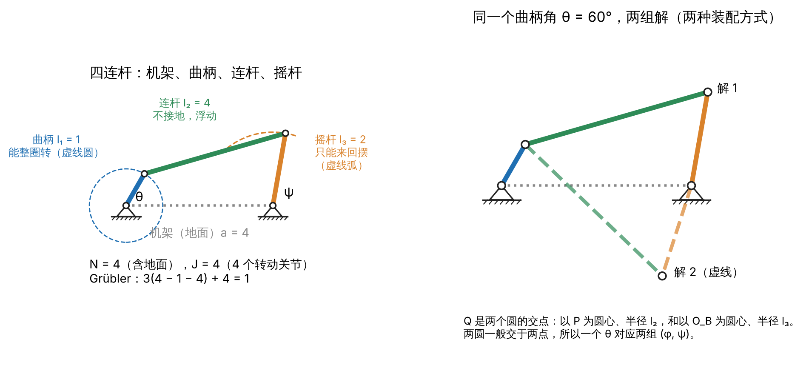

四连杆的四根杆：**机架**是固定不动的那根，也就是地面，「四」把它算在内；**曲柄**接在机架上，能整圈转动；**摇杆**也接在机架上，只能来回摆；**连杆**两端都不接地，连接曲柄和摇杆。

哪根能整圈转，由杆长决定。设最短杆长 $s$、最长杆长 $l$，另两根为 $p$、$q$。**Grashof 条件** $s + l \le p + q$ 成立时，至少有一根杆能相对相邻的杆整圈转动；最短杆与机架相邻时是曲柄摇杆机构。上图杆长 1、2、4、4，$1 + 4 \le 2 + 4$，最短杆接在机架上，所以是曲柄摇杆机构。右半边的两组解留到最后一节讲。

## 闭链不能直接相加

看上图的四连杆：地面加 3 个运动连杆，4 个转动关节。3 个运动连杆共 9 个坐标，4 个转动关节在平面里各施加 2 个约束，共 8 个，$9 - 8 = 1$。各关节自由度之和却是 4。

原因是最后一个关节要把回路合上，它的约束涉及两个已经摆好的连杆。开链里每个关节的约束只涉及刚接上的那个连杆，闭链不是。

## Grübler 公式

设机构有 $N$ 个连杆（**含地面**）、$J$ 个关节，关节 $i$ 允许 $f_i$ 个自由度，施加 $m - f_i$ 个约束，$m$ 是单个刚体的自由度（平面 3，空间 6）。地面固定，其余 $N - 1$ 个连杆不受约束时共 $m(N-1)$ 个自由度，每个关节去掉 $m - f_i$ 个：

$$
\begin{aligned}
\mathrm{dof} &= m(N-1) - \sum\_{i=1}^{J} (m - f_i) \
&= m(N - 1 - J) + \sum\_{i=1}^{J} f_i
\end{aligned}
$$

**公式成立的前提是：在所考虑的位形上全部关节约束互相独立。** 也就是说，系统并不处于奇异位型，使得满足某一关节的某些约束自动满足其他关节的某些约束。若如此，会有新的自由度被释放。后面几节都在讲它什么时候不成立。

数 $N$ 和 $J$ 的规矩：

- 地面算一个连杆，计入 $N$。关节不是连杆，接地的关节计入 $J$。
- $k$ 个连杆在同一点用同一根轴铰在一起，算 $k - 1$ 个关节。
- 开链 $J = N - 1$，代进去得 $\sum f_i$，就是上一篇的结论；单回路 $J = N$。
- 一个只有两个关节的构件，可以连同这两个关节合并成一个关节，$f = f_1 + f_2$。$N$ 和 $J$ 各减 1，$\sum f_i$ 不变，结果也不变。曲柄滑块里的滑块就可以这样合并：它允许转动，也允许沿导轨平移，$f = 2$，相当于静力学里的滚动支座。代价是滑块不再是一个刚体，到了动力学要算它的质量时，得把它拆回来。

对照书上的例题，各机构的计数如下：

| 机构 | m | N | J | Σfᵢ | Grübler | 实际 |
| --- | --- | --- | --- | --- | --- | --- |
| 四连杆（例 2.3） | 3 | 4 | 4 | 4 | 1 | 1 |
| 曲柄滑块（例 2.3） | 3 | 4 | 4 | 4 | 1 | 1 |
| 五杆机构（例 2.4） | 3 | 5 | 5 | 5 | 2 | 2 |
| Stephenson、Watt 六杆（例 2.4） | 3 | 6 | 7 | 7 | 1 | 1 |
| 平行四边形机构（例 2.6） | 3 | 5 | 6 | 6 | 0 | 1 |
| Delta 机器人（例 2.7） | 6 | 17 | 21 | 45 | 15 | 15，末端只有 3 |
| Stewart–Gough 平台，U–P–S（例 2.8） | 6 | 14 | 18 | 36 | 6 | 6 |

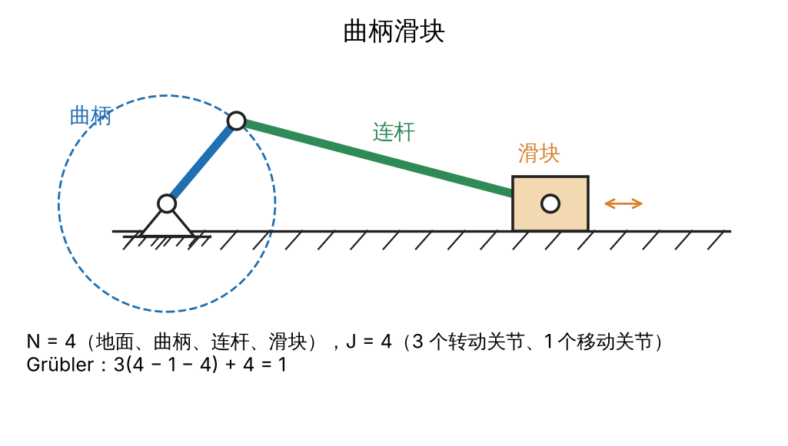

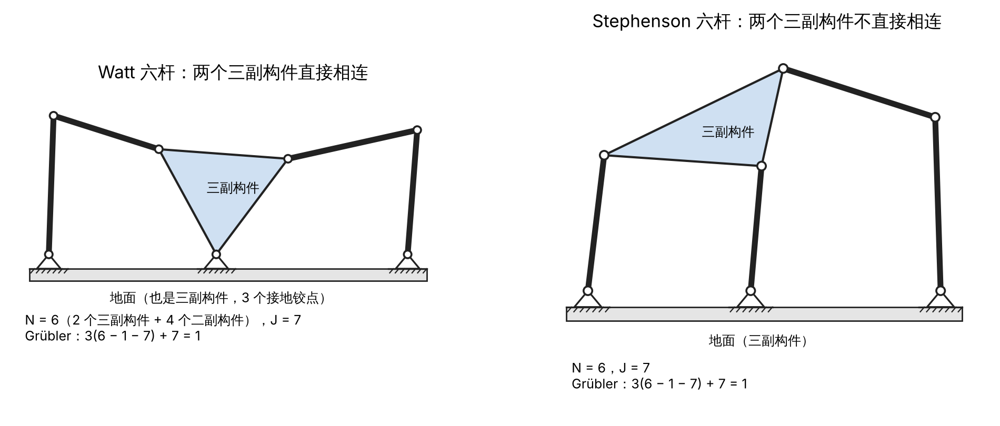

六杆机构有两个三副构件（有三个铰点的刚体，画成三角形）和四个二副构件。两个三副构件直接相连的叫 Watt 型，不直接相连的叫 Stephenson 型。

平行四边形算出 0 却能动，Delta 算出 15 而末端只有 3 个。下面分别解释。

## 前提失效：约束不独立

Grübler 只数了连杆、关节的个数和种类，完全没看**尺寸**和**位形**，可约束是否独立恰恰取决于这两样。约束不独立时，实际去掉的维数少于 $\sum (m - f_i)$，所以实际自由度**大于等于** Grübler 的结果，Grübler 给的是**下界**。

判据只有一个：把全部约束写成方程组 $g(q) = 0$，雅可比矩阵 $\partial g / \partial q$ 在位形 $q$ 处的秩小于约束个数，约束就不独立（9-04 会正式讲）。秩不足有两种来源，名字要分开：

|  | 特殊尺寸（多余约束） | 奇异位形 |
| --- | --- | --- |
| 秩 | 在整个运动范围内都一样低 | 只在个别位形比周围低 |
| 例子 | 平行四边形机构：Grübler 0，实际 1；Bennett 机构：Grübler −2，实际 1 | 五杆机构两根等长的中间杆折叠重合时，多出 1 个自由度 |
| 怎么判别 | 换一组尺寸，约束就独立了 | 换一个位形，约束就独立了 |
| 位形空间 | 仍然光滑，自由度处处相同 | 在那一点可能不光滑，几条运动分支可能在那里交叉 |
| 工程上的代价 | 对制造误差敏感：差一点就装不上，或者靠变形硬装、带着内应力 | 局部自由度突变，控制和受力在那里出问题 |
| 对策 | 去掉多余约束再算；设计时去掉它，或者保证精度、故意用它加刚度 | 规划轨迹时绕开 |

「奇异」的本意是**例外**。秩处处一样低时，低秩就是这个机构的常态，所以平行四边形机构在运动范围内没有奇异位形，只有多余约束。同一个机构也可以两种都有：两根曲柄等长、机架和连杆等长的平行四边形四连杆，在四根杆共线时有一个真正的奇异位形，可以在那里从平行四边形分支翻到交叉的反平行四边形分支。

### 特殊尺寸：平行四边形机构

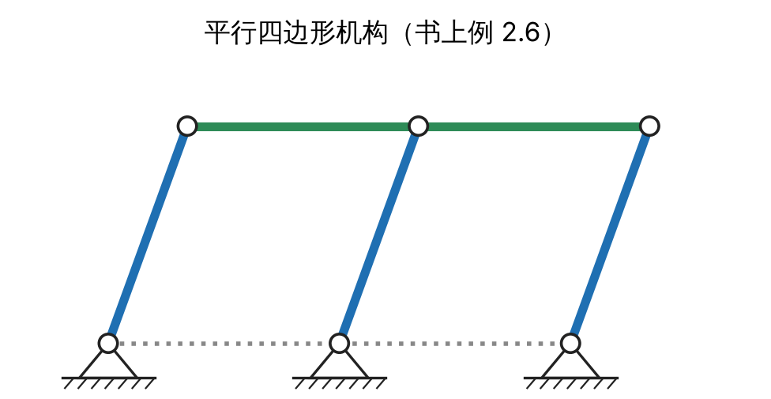

三根竖杆等长且平行，上面的绿色长杆是**一个**刚体，开了三个孔。$N = 5$（地面、3 根竖杆、上杆），$J = 6$，Grübler $= 3(5 - 1 - 6) + 6 = 0$。可它显然能动。

拿掉中间那根竖杆，剩下的平行四边形四连杆有 1 个自由度，上杆做平移。在这个平移下，上杆中点到中间地面铰点的距离始终等于竖杆长度。所以把中间竖杆装回去时，它带来 3 个坐标、4 个约束，其中「上杆中点到中间铰点的距离等于杆长」这 **1 个**已经被自动满足，另外 3 个仍要用来确定竖杆的位置。全机构 12 个坐标、12 个约束，独立的只有 11 个，$12 - 11 = 1$。中间竖杆稍长或稍短一点，它就装不上，Grübler 的 0 就对了。

更极端的是空间 Bennett 机构：四根杆、四个转动关节连成回路，$6(4 - 1 - 4) + 4 = -2$；但杆长和轴线夹角满足特定关系时，它能以 1 个自由度运动。一般尺寸下，Grübler 得 0 是一个动不了的结构，比如三根杆铰成的三角形，$3(3 - 1 - 3) + 3 = 0$；得负数说明约束比坐标还多，根本装不上，只有尺寸恰好配合时才装得上，而那时必然有多余约束。平行四边形和 Bennett 机构就是尺寸恰好配合的例子，所以 Grübler 算出 0 不一定是结构，算出负数也不一定不能动。

### 奇异位形：五杆折叠

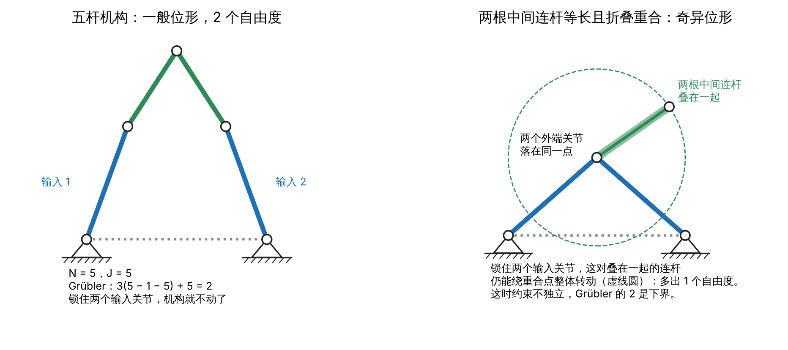

平面五杆机构一般有 2 个自由度：锁住两个接地的输入关节，它就不动了。假设两根中间连杆等长，让它们折叠重合，两端的关节落在同一个点上。这时即使锁住两个输入关节，这对折叠的连杆还能绕那个重合点一起转，多出 1 个自由度。离开这个位形，多出的自由度就消失了。

## 内部自由度：末端看不到的自由度

Grübler 数的是**整个机构**的自由度，有些只在机构内部。

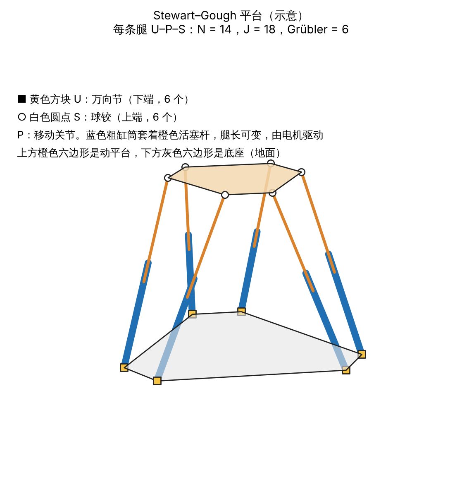

Stewart 平台的六条腿如果都是「球铰–移动关节–球铰」（S–P–S），Grübler 算出 12。数 $N$ 时，每条腿是缸筒和活塞杆两个刚体，加底座和动平台，$N = 12 + 1 + 1 = 14$，$J = 18$，$6(14 - 1 - 18) + 6 \times 3 + 6 \times 1 + 6 \times 3 = 12$。平台本身只有 6 个，另外 6 个是每条腿绕两个球心的连线自转：腿转了，两端的球心都不动，平台和其他腿都不受影响。把下端的球铰换成万向节（U–P–S），万向节不允许这种自转，Grübler 就得 6。

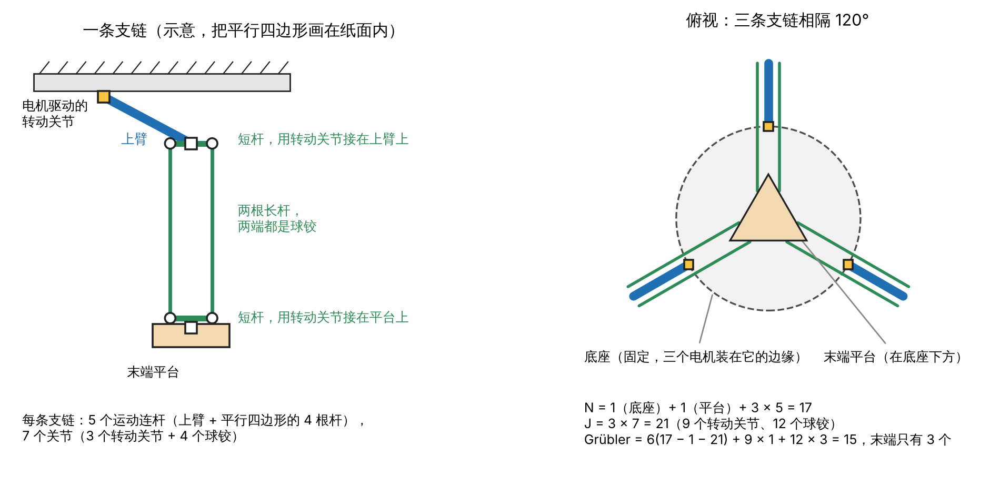

Delta 机器人是同一类现象。上方的底座固定，三个电机装在它的边缘，各驱动一条上臂；每条支链还有一个平行四边形，两根长杆两端都是球铰，两根短杆用转动关节分别接在上臂和末端平台上。Grübler 算出 15，末端只有 3 个（平行四边形让末端平台始终和底座平行，只能平移）。多出的 12 个，是每条支链平行四边形的 4 根杆各自绕两端铰点中心的连线自转，$3 \times 4 = 12$。这里有一个图上看不出的建模细节：按书上的模型，短杆两个转动关节的转轴都沿着短杆本身，所以短杆也能这样自转。两端的点不动，这些转动不牵动任何别的构件，末端看不到。

实际的 Delta 产品里，短杆通常和上臂、平台做成一体，只有长杆两端是球铰。这时 $N = 11$，$J = 15$，Grübler $= 6(11 - 1 - 15) + 3 + 36 = 9 = 3 + 6$，内部自由度只剩 6 根长杆的自转。

## 没有地面的机构

飞行器、腾空的人形机器人没有哪个连杆是固定的，$N$ 个连杆全都能动：

$$
\mathrm{dof} = m(N - J) + \sum\_{i=1}^{J} f_i
$$

等价的看法：假想地面还在，用一个 $f = 6$ 的「自由关节」把躯干接到地面上，再照常用 Grübler。MuJoCo 的 free joint、Pinocchio 的 free-flyer 就是这个假想的关节，它占 7 个位置坐标（位置 3 个加四元数 4 个）、6 个速度坐标。四旋翼是一个刚体，6 个自由度，却只有 4 个电机，这叫欠驱动。腾空的人形机器人有 $6 + n$ 个自由度，$n$ 是关节数；一着地，脚和地面的接触就成了新的约束，9-04、9-05 会算。

## 和项目的关系：腿打直

人形机器人双脚踩地时，「地面—左腿—骨盆—右腿—地面」形成闭链，自由度要用这一篇的方法数，9-05 会算。这里先看一个和奇异有关的问题：膝关节完全打直时会怎样？

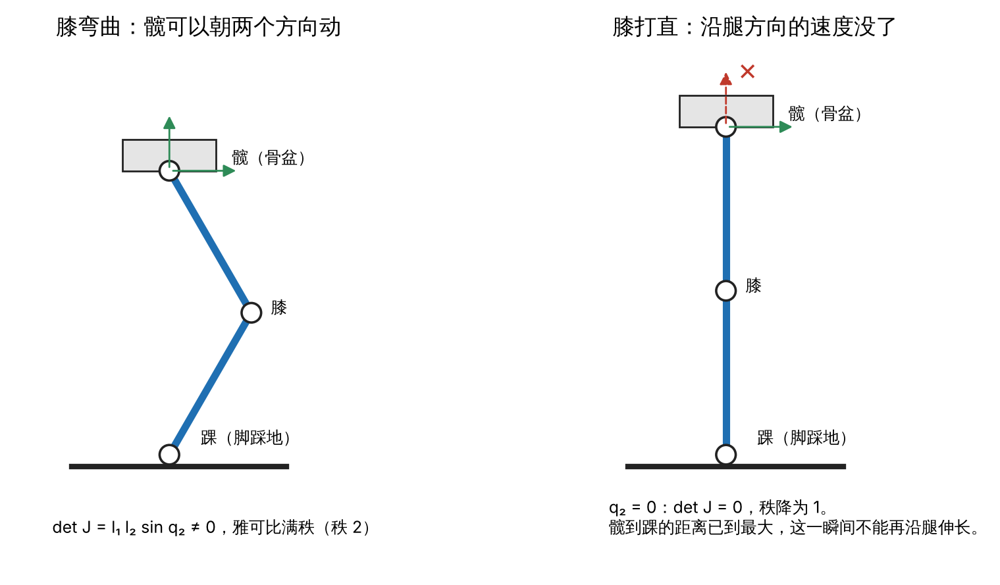

只看一条腿，在矢状面里简化成平面两连杆：大腿长 $l_1$，小腿长 $l_2$，膝关节角 $q_2$（打直时 $q_2 = 0$）。把关节速度映射成髋相对踝的速度的雅可比矩阵，行列式是 $l_1 l_2 \sin q_2$（9.5 会推导）。膝弯曲时它不为 0，髋可以朝平面内任意方向动；$q_2 = 0$ 时行列式为 0，秩从 2 降到 1，髋到踝的距离已到最大，这一瞬间无论膝关节转多快，髋都不能沿腿的方向移动。

这和五杆折叠不是同一类奇异。在双脚站立的平面模型里（每条腿踝、膝、髋三个转动关节），膝弯曲和打直时闭链约束雅可比的秩都是 3，约束仍然独立，自由度个数不变；变的是每条腿自己的雅可比，打直时从秩 3 降到 2，骨盆失去了一些方向的运动能力。腿打直这类叫串联型（第一类）奇异，末端失去运动方向；五杆折叠那类叫并联型（第二类）奇异，锁住输入后机构反而多出能动的方向（Gosselin & Angeles，1990）。

## 动手：用数值方法解四连杆

两个固定铰点 $O_A = (0, 0)$、$O_B = (a, 0)$，曲柄长 $l_1$ 接在 $O_A$，连杆长 $l_2$，摇杆长 $l_3$ 接在 $O_B$。用绝对角度：曲柄 $\theta$、连杆 $\varphi$、摇杆 $\psi$，都从 $x$ 轴量起。从 $O_A$ 经曲柄、连杆走到连杆末端 Q，和从 $O_A$ 经机架、摇杆走到 Q，是同一个点：

$$
\begin{aligned}
l_1 \cos\theta + l_2 \cos\varphi &= a + l_3 \cos\psi \
l_1 \sin\theta + l_2 \sin\varphi &= l_3 \sin\psi
\end{aligned}
$$

3 个未知角、2 个方程，剩 1 个自由度，和 Grübler 一致。用 scipy 的 `fsolve`，给定 $\theta$ 解 $(\varphi, \psi)$，让 $\theta$ 从 0 扫到 360°。杆长取 $a = 4$、$l_2 = 4$、$l_3 = 2$，曲柄 $l_1$ 先取 1，再取 1.8。

### 两种装配方式

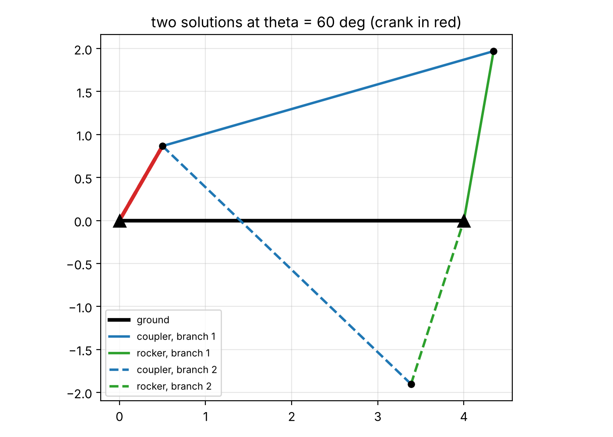

Q 是两个圆的交点：一个以曲柄末端 P 为圆心、半径 $l_2$，一个以 $O_B$ 为圆心、半径 $l_3$。两个交点关于直线 $PO_B$ 对称，所以同一个 $\theta$ 下的两组解互为镜像：三角形 $P,Q,O_B$ 沿 $PO_B$ 翻折。记 $d = |PO_B|$：

- $|l_2 - l_3| < d < l_2 + l_3$ 时有两个解；
- 取等号时两解重合，连杆和摇杆共线，是奇异位形；
- 超出范围就装不上。

这组杆长下 $d$ 在 $[a - l_1, a + l_1]$ 里变化，$l_1 = 1$ 时是 $[3, 5]$，$l_1 = 1.8$ 时是 $[2.2, 5.8]$，都落在 $(2, 6)$ 之内。所以两条分支永不相交，位形空间是两个互不相连的圈：机构不拆开，就不可能从一种装配方式变到另一种。

### 延拓：用上一步的解作初值

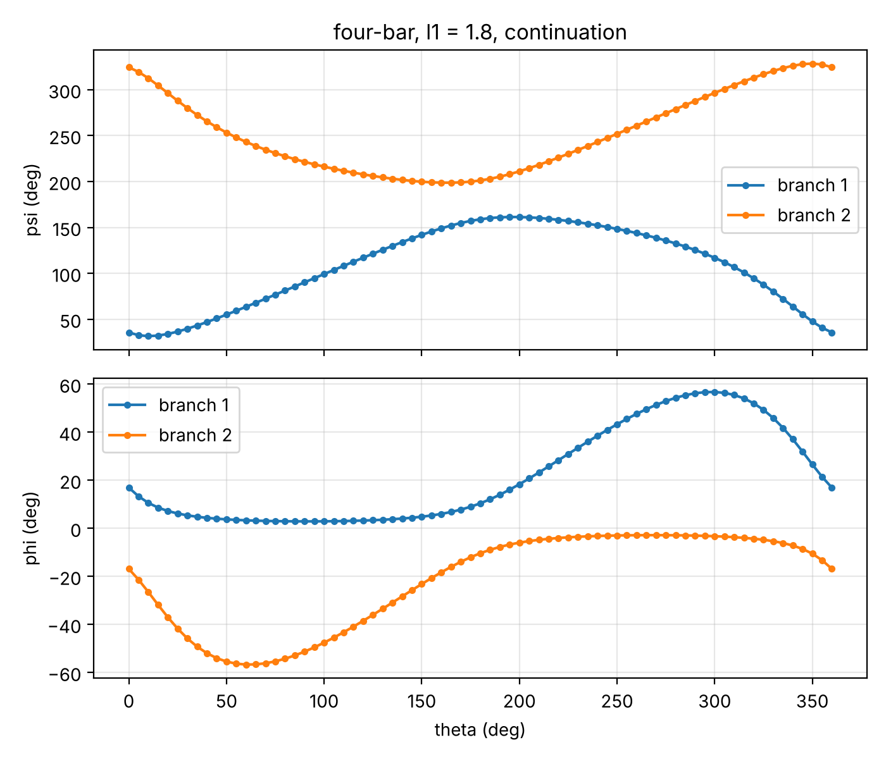

每一步都用上一步的解作初值，`fsolve` 就沿同一条分支走下去，两条曲线都连续扫完一整圈。

### 固定初值：悄悄跳到另一条分支

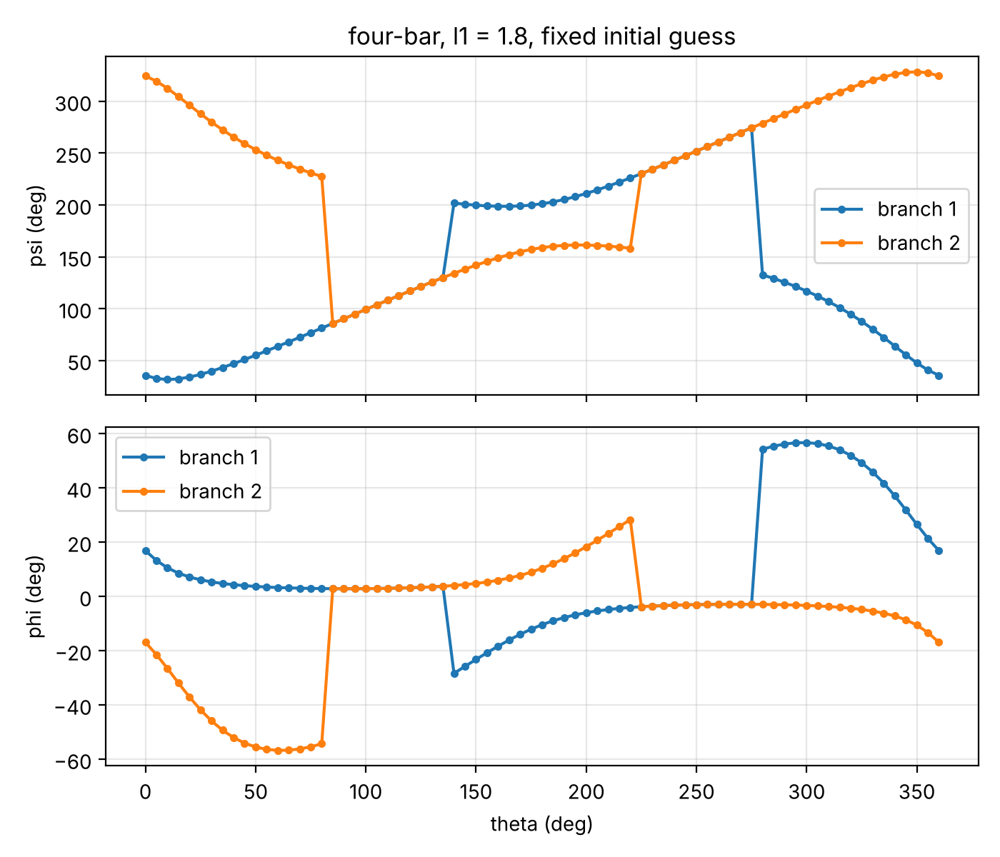

$l_1 = 1.8$ 时，如果每一步都从 $\theta = 0$ 的那组解出发，算出来的点会在两条分支之间来回跳。比如蓝线在 135° 和 140° 之间跳到了另一条分支，而且这时初值离原来的分支更近，`fsolve` 还是落到了另一组解上。每个点都是真解，残差约 $10^{-9}$，`fsolve` 也报收敛；可物理上，机构不拆开就不可能从一种装配方式跳到它的镜像。

残差查不出这种错，因为两组解都精确满足方程。能查出来的是雅可比行列式的符号：闭环方程对 $(\varphi, \psi)$ 的雅可比行列式是 $l_2 l_3 \sin(\varphi - \psi)$，它的符号代表装配方式，在同一条分支上不变号。

我原先以为固定初值的风险是「可能找不到解」。实际出现的是另一种、更危险的失败：每一步都给出一个看起来完全正确的答案，只是答案不连续。机械臂的数值逆运动学也用上一步的解作初值，原因相同（9.6 会讲）。

## 注

- **一个刚体可以有不止两个关节。** 平行四边形机构的上杆可以是一个刚体，只是三个铰点恰好共线。
- **平行四边形例子** 它在每个位形都能动，没有哪个位形是例外，属于特殊尺寸。
- **Delta 多出的 12 个自由度不在底座和上臂上。** 底座是地面，固定不动；三条上臂各由一个电机驱动，锁住电机，上臂和末端都不动。多出的是平行四边形里 12 根杆的自转。

## 来源

- Kevin M. Lynch, Frank C. Park, \_Modern Robotics: Mechanics, Planning, and Control\_，2.2.2 节，例 2.3–2.8；作者官网有免费的[预印本](https://hades.mech.northwestern.edu/images/2/25/MR-v2.pdf)。
- G. T. Bennett, "A New Mechanism," _Engineering_ 76, 1903.
- C. Gosselin, J. Angeles, "Singularity Analysis of Closed-Loop Kinematic Chains," _IEEE Transactions on Robotics and Automation_ 6(3), 1990.
- 机构示意图为学习时自绘；三张曲线图由我的 control-theory-lab 仓库里的四连杆求解脚本生成。
