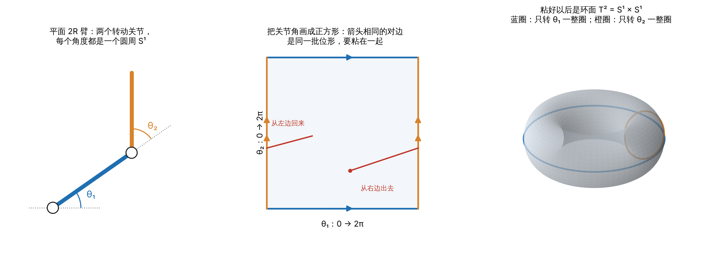
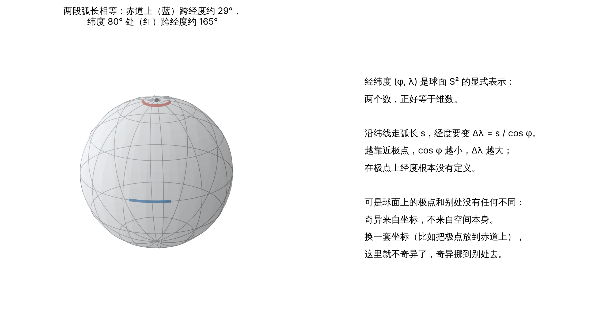

9.1 位形空间与自由度 · 单元 9-03 · 对照 Lynch & Park《Modern Robotics》2.3

前两篇只回答了一个问题：位形空间有几维，也就是自由度。这一篇回答另外两个问题：位形空间整体拓扑，以及如何表示一个位形。并结合 MuJoCo、Pinocchio 引申说明，为什么位置坐标的个数 `nq` 和速度坐标的个数 `nv` 不相等；为什么机器人的姿态不能随便用三个角来记。

## 1 位形空间

### 1.1 定义

**位形**是机器人上每一个点位置的完整描述；
**位形空间**是所有可能位形的集合；维数就是自由度。
_单摆只要一个角度就能确定，位形空间是一维的；空间中的一个刚体要 6 个数，位形空间是六维的。_

### 1.2 维数一样，形状可以不同

单摆的位形空间是一维的，一条直线也是一维的，但它们不一样：单摆朝一个方向一直转，会回到出发点；在直线上一直走，永远回不来。单摆的位形空间是**圆周** S¹，不是直线 ℝ。同样，球面摆的位形空间是球面 S²，它和平面 ℝ² 都是二维的，但在球面上一直往前走会绕回来。

这里的"形状"指**拓扑**：两个空间如果能通过连续的拉伸、弯曲（不撕开、不粘合）相互转换，就是拓扑等价的。大球、小球、橄榄球的表面彼此等价；圆周和直线不等价，因为要把圆周变成直线，必须在某处剪开。

- **拓扑是空间本身的性质，和坐标无关。** 圆周上的点可以用一个角 θ 记，也可以用 (x, y) 加约束 x² + y² = 1 记，圆周还是那个圆周。
- **维数是局部的，拓扑是整体的。** 在任何一个位形附近，单摆只要一个实数就够描述；但整个圆周不能用一个区间不重不漏、连续地记下来。

还有一个细节：开区间和直线拓扑等价，闭区间不等价，因为它有端点。有限位的转动关节，位形空间就是一个闭区间。

### 1.3 独立部分的笛卡尔积

互相独立的部分，位形空间就是各部分的**笛卡尔积**：每一部分各取一个点，拼成一个位形；维数相加。

| 系统 | 位形空间 | 一种记法 |
|---|---|---|
| 平面上的点 | ℝ² | (x, y) |
| 单摆（转动关节，无限位） | S¹ | θ |
| 球面摆 | S² | 经纬度 |
| 平面 PR 臂（移动 + 转动） | ℝ × S¹ | (d, θ) |
| 平面 2R 臂 | S¹ × S¹ = T² | (θ₁, θ₂) |
| 平面刚体 | ℝ² × S¹ | (x, y, θ) |
| 空间刚体 | ℝ³ × SO(3) | 见第 2 节 |

n 个圆周的乘积是 n 维**环面** Tⁿ，不是球面 Sⁿ。

### 1.4 例子：平面 2R 臂的位形空间是环面

两个关节角各在一个圆周上、互相独立，所以位形空间是 S¹ × S¹。把 θ₁、θ₂ 都限制在 [0, 2π) 画成一个正方形；θ = 0 和 θ = 2π 是同一个位形，所以左右两条边要粘起来，上下两条边也要粘起来，得到一个环面。



它不是 ℝ²，因为把关节 1 转一整圈就回到了原来的位形；它也不是 S²，因为球面上任何闭合的圈都能连续缩成一点，而环面上"只转关节 1 一整圈"的圈套着环面的洞，缩不掉。

要分清两个空间：环面是**关节角**的空间。末端能到达的地方是**工作空间**，对平面 2R 臂来说是平面上的一个圆环 |l₁ − l₂| ≤ r ≤ l₁ + l₂。末端够不到某些地方，是杆长决定的，和环面的拓扑没有关系。

加上关节限位后，正方形的边不再粘合，环面的拓扑就消失了，位形空间变成一个闭矩形。人形机器人的关节几乎都有限位，所以关节部分拓扑上就是一个高维的盒子，拓扑上不平凡的只有浮动基的转动部分。

### 1.5 空间刚体：ℝ³ × SO(3)

数自由度时，可以把空间刚体拆成三步：一个点的位置在 ℝ³，一个方向在 S²，绕这个方向的转角在 S¹，所以常被写成 ℝ³ × S² × S¹。维数没问题，但转动部分整体上不是 S² × S¹ 的直积，严格写法是 **SO(3)**：所有空间转动组成的集合。两者在任何一个姿态附近看起来一样，整体不同：在 SO(3) 里，"绕一根固定轴转 360°"这个圈不能缩成一点，转 720° 的圈却可以。

**托盘实验**
手掌朝上托一本书，保持手掌朝上，让书绕竖直轴转。转一圈，书的朝向回到了原样，手臂却拧着，回不到初始姿势；同方向再转一圈，手臂自然回到了初始姿势。


- **转 720° 能复原、转 360° 不能，是 SO(3) 的拓扑决定的。** 人手臂的每个关节都有限位，关节空间是一个"盒子"，所以手臂的姿势不仅决定了手的朝向，还能唯一地对应到一个单位四元数（第 2 节），也就是说，手臂"记得"手的四元数是 q 还是 −q。转一圈后手的朝向复原了，但对应的四元数是 −1，手臂必然和开始时不同；转两圈回到 +1，手臂才能复原。如果机器人的手腕有一个能无限转的关节，就没有这个现象。
- **第二圈时手的位置必须移动，是关节限位决定的。** 这是机构的性质，不是拓扑。

*此处预留 MATLAB 脚本*

## 2 表示：显式与隐式

拓扑是空间本身层面的概念。要计算某一时刻的位姿，需要选一组数来记位形，这就是**表示**。


### 2.1显式表示

**显式表示（参数化）**：参数与自由度数量相等，例如圆周用一个角 θ，球面用经纬度，姿态用三个欧拉角。

这组参数是一组**局部坐标**。在每一点上，每个参数单独变化的方向，构成这一点"速度空间"（切空间）的一组基。

**优势**：是数最少，没有额外的约束要维护，在正常的点上，参数的每一点变化都对应真实的位形变化。

**代价**：是可能有**表达奇异点**：在表达奇异点处，这组基退化了。
#### 2.1.1  球面示例：经纬度的奇异


在单位球面上，纬度 φ 处的纬线圈半径是 r = cos φ。沿纬线走一段弧长 s，经度要变

$$
\Delta\lambda = \frac{s}{r} = \frac{s}{\cos\varphi}
$$



越靠近北极，φ 趋于 90°，r 趋于 0，同样的移动要求的经度变化越来越大：一个点以恒定速率经过北极时，λ̇ 趋于无穷大，数值计算越来越失真。到了北极，改变经度，位置根本不动：经度方向在那里退化了，经度本身也没有定义。

可是球面上的北极和别处没有任何不同。这种奇异来自坐标，不来自空间。把"北极"换到赤道上（换一套坐标），这里就不奇异了，奇异挪到了别处。

#### 2.1.2 两种奇异

| | 表达奇异 | 机构奇异 |
|---|---|---|
| 来源 | 坐标选得不好，纯数学问题 | 机构本身的性质 |
| 例子 | 经纬度的极点、欧拉角的万向节锁 | 手臂完全伸直、五杆机构折叠 |
| 判据 | 换一套坐标就消失 | 换任何坐标都还在，雅可比在任何坐标下都掉秩 |
| 处理 | 用几套坐标各管一块，重叠处互相换算（图册，atlas）；或者改用隐式表示 | 规划和控制里绕开（冗余自由度、阻尼最小二乘），必要时改结构 |

所以经纬度在北极的奇异和机械臂雅可比行列式为 0 不是一回事。前者换一套坐标就没了；后者是机构真的在那个位形少了一个能动的方向。

### 2.2 隐式表示

把空间看成嵌在更高维欧氏空间里的一张"曲面"，用比维数多的数，再加约束：维数 = 数的个数 − 独立约束的个数。

| 空间 | 隐式表示 | 数的个数 | 约束个数 | 维数 |
|---|---|---|---|---|
| 圆周 S¹ | (x, y)，x² + y² = 1 | 2 | 1 | 1 |
| 球面 S² | (x, y, z)，x² + y² + z² = 1 | 3 | 1 | 2 |
| 姿态 SO(3) | 3 × 3 旋转矩阵 R，RᵀR = I，det R = 1 | 9 | 6 | 3 |
| 姿态 SO(3) | 单位四元数 q，‖q‖ = 1 | 4 | 1 | 3 |

**优势**：**没有表达奇异点**，旋转矩阵和姿态一一对应、处处光滑；单位四元数也处处光滑， q 和 −q 表示同一个姿态。

**代价**：计算复杂。
- **约束要一直维护。** 以球面为例，x、y、z 不是独立的，它们被一个非线性约束 x² + y² + z² = 1 联系在一起。所以 (x, y, z) 的变化必须落在切平面里（和 (x, y, z) 垂直），数值积分之后还要重新归一化。四元数要重新归一化，旋转矩阵要重新正交化，道理一样。
- **速度不能直接加到位置上。** 姿态只有 3 维，角速度只有 3 个分量，四元数却有 4 个数，"位置 + 速度 × 时间"连维数都对不上，必须用专门的积分方法。

*后续基本使用单位四元数（隐式表示）*

### 2.3 参数个数和自由度的关系

把上面的内容归纳一下，位形空间是 n 维时：

- **参数少于 n**：表示不了。
- **参数等于 n**：位形空间是 ℝⁿ 那样"敞开"的时候没有问题，平面上的点用 (x, y) 就没有任何奇异。但对圆周、球面、SO(3)、环面这类有界又没有边的空间，n 个参数一定有缺陷，而且缺陷分两种：圆周和环面用角度，只有 2π 处的一条"接缝"，θ 和 θ + 2π 是同一个位形，取模就能处理，速度不会发散；球面和 SO(3) 有真正的奇点，在那里速度会发散。对 SO(3)，任何只用三个参数的姿态表示都有奇异点（Stuelpnagel, *SIAM Review* 6(4), 1964）。
- **参数多于 n**：可以消除表达奇异点。三维姿态最常用的是单位四元数：4 个参数，1 个模长约束。

| | 显式表示 | 隐式表示 |
|---|---|---|
| 数的个数 | 等于维数 | 多于维数 |
| 约束 | 没有 | 有，要一直维护 |
| 奇异 | 拓扑不平凡时一定有缺陷 | 没有 |
| 例子 | θ、经纬度、欧拉角 | (cos θ, sin θ)、(x, y, z) 加约束、旋转矩阵、四元数 |

## 3 nq 和 nv

仿真器和动力学库把两种表示组合起来用：**位置用隐式表示，速度用最少的数。**

- `nq`：位置坐标的个数；`nv`：速度坐标的个数。
- 速度可以放心用最少的数，因为每一点上的速度空间（切空间）是一个普通的 n 维向量空间，没有拓扑问题，用 n 个数表示不会有任何奇异。有拓扑问题的只是位置。
- 没有闭环的机构，nv 等于自由度；nq 可以更多。有闭环时，nv 按所有关节算，比自由度多，闭环约束再把它减下来（[9-02](/theory/robot-kinematics-dynamics/9-02-grubler/)）。

**浮动基**是最重要的例子。一个自由飞行的刚体：

- nq = 7：某个参考点的位置 3 个，加一个单位四元数 4 个（4 个参数减 1 个模长约束，正好 3 个转动自由度）；
- nv = 6：刚体此刻的全部运动，沿 x、y、z 的线速度 3 个，加角速度 3 个。

因为 nq ≠ nv，位置往前推一步不能写成 q + v Δt，要按关节类型分别处理：普通关节直接相加，四元数部分用指数映射（9-06）。

## 4 和 MuJoCo 的关联

### 4.1 MuJoCo四种关节

| 关节 | 位置坐标 | nq | 速度坐标 | nv |
|---|---|---|---|---|
| hinge（转动） | 角度 | 1 | 角速度 | 1 |
| slide（移动） | 位移 | 1 | 速度 | 1 |
| ball（球铰） | 单位四元数 | 4 | 角速度 | 3 |
| free（浮动基） | 位置 3 + 单位四元数 4 | 7 | 线速度 3 + 角速度 3 | 6 |

MuJoCo 的四元数顺序是 (w, x, y, z)，实部在前。Pinocchio 的浮动基同样是 nq = 7、nv = 6；它还把 URDF 里没有限位的 continuous 关节表示成 (cos θ, sin θ)，nq = 2、nv = 1，正是圆周的隐式表示。

### 4.2 example

一个带 free joint 的基座，接两个 hinge，末端接一个 ball：

```xml
<mujoco>
  <worldbody>
    <body name="base">
      <freejoint/>
      <geom type="box" size="0.1 0.1 0.1"/>
      <body name="link1" pos="0.2 0 0">
        <joint name="hinge1" type="hinge" axis="0 0 1"/>
        <geom type="capsule" fromto="0 0 0 0.3 0 0" size="0.02"/>
        <body name="link2" pos="0.3 0 0">
          <joint name="hinge2" type="hinge" axis="0 0 1"/>
          <geom type="capsule" fromto="0 0 0 0.3 0 0" size="0.02"/>
          <body name="hand" pos="0.3 0 0">
            <joint name="wrist" type="ball"/>
            <geom type="sphere" size="0.04"/>
          </body>
        </body>
      </body>
    </body>
  </worldbody>
</mujoco>
```

按上表，nq = 7 + 1 + 1 + 4 = 13，nv = 6 + 1 + 1 + 3 = 11。用 MuJoCo 3.16 加载，`model.nq`、`model.nv` 正是 13 和 11。每个关节在 `qpos`、`qvel` 里的起始下标：

| 关节 | qpos 起始（`jnt_qposadr`） | qvel 起始（`jnt_dofadr`） |
|---|---|---|
| free | 0 | 0 |
| hinge1 | 7 | 6 |
| hinge2 | 8 | 7 |
| wrist（ball） | 9 | 8 |

下标从第一个关节之后就对不齐了，所以读写关节状态时要用 `jnt_qposadr` 和 `jnt_dofadr` 去找，不能拿同一个下标同时索引 `qpos` 和 `qvel`。

初始的 `qpos` 是 (0, 0, 0, 1, 0, 0, 0, 0, 0, 1, 0, 0, 0)：两个四元数都是 (1, 0, 0, 0)，不是全 0。全 0 的四元数长度为 0，不是任何转动；(1, 0, 0, 0) 才是"不转"。

### 4.3 在仿真器里看到 720°

只给浮动基一个绕 z 轴 π rad/s 的角速度，用 `mujoco.mj_integratePos` 以 0.01 s 的步长积分，浮动基的四元数：

| 步数 | 转过的角度 | 四元数 (w, x, y, z) |
|---|---|---|
| 100 | 180° | (0, 0, 0, 1) |
| 200 | 360° | (−1, 0, 0, 0) |
| 400 | 720° | (1, 0, 0, 0) |

转 360° 后，刚体的姿态已经复原，四元数却是 −1；转 720° 才回到 +1。这和托盘实验是同一件事：四元数就像那条手臂，记得转了一圈还是两圈。

### 4.4 对控制和学习的影响

人形机器人的关节都是 hinge，再加一个浮动基，所以 nq = 7 + n，nv = 6 + n。以 29 个关节的 G1 为例，nq = 36，nv = 35。

- 机身姿态用四元数存、用四元数算，不要转成欧拉角再做运算：机身接近翻倒时会碰上万向节锁。
- 神经网络是连续函数，输入的表示最好也连续。四元数有 q 和 −q 的问题，欧拉角有奇异和跳变，所以策略的观测里常用重力方向在机身坐标系里的投影，或者旋转矩阵的前两列（6 个数）。后者有理论依据：把姿态映射成 4 个或更少的数，这个映射一定不连续；映射成 5 个或 6 个数才能连续（Zhou et al., "On the Continuity of Rotation Representations in Neural Networks", CVPR 2019）。

## 小结

- 位形空间的维数是局部的，拓扑是整体的；独立部分的位形空间是笛卡尔积，2R 臂是环面，空间刚体是 ℝ³ × SO(3)。
- 显式表示用最少的数，拓扑不平凡时一定有缺陷；隐式表示多用几个数加约束，没有表达奇异，代价是要维护约束。
- 表达奇异换坐标就消失，机构奇异换什么坐标都在。
- 仿真器里位置用隐式表示、速度用最少的数，所以 nq ≠ nv：浮动基 7 对 6，ball 4 对 3。
- SO(3) 里转 360° 回不到原处、转 720° 可以，托盘实验和四元数的符号是同一件事。

## 来源

- Kevin M. Lynch, Frank C. Park, *Modern Robotics: Mechanics, Planning, and Control*，2.3 节；作者官网有免费的[预印本](https://hades.mech.northwestern.edu/images/2/25/MR-v2.pdf)。
- John Stuelpnagel, [On the Parametrization of the Three-Dimensional Rotation Group](https://doi.org/10.1137/1006093), *SIAM Review* 6(4): 422–430, 1964。
- Yi Zhou, Connelly Barnes, Jingwan Lu, Jimei Yang, Hao Li, [On the Continuity of Rotation Representations in Neural Networks](https://openaccess.thecvf.com/content_CVPR_2019/html/Zhou_On_the_Continuity_of_Rotation_Representations_in_Neural_Networks_CVPR_2019_paper.html), CVPR 2019。
- 4.2、4.3 节的数字用 MuJoCo 3.16 实际运行得到。
