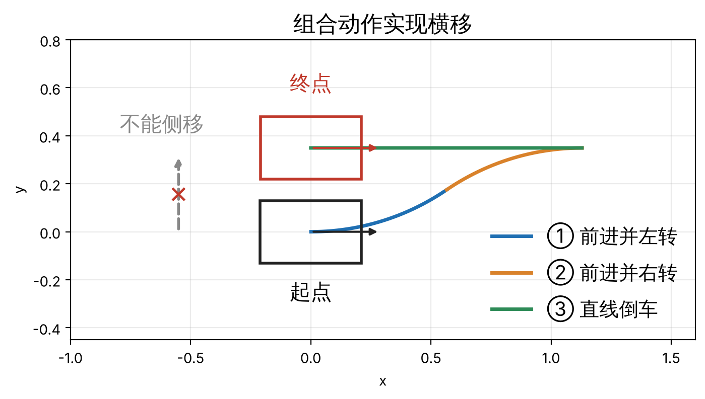

9.1 位形空间与自由度 · 单元 9-04 · 对照 Lynch & Park《Modern Robotics》2.4、2.5

前三篇讨论位形空间有几维、整体拓扑和如何表示。这一篇补上三件事：有些约束不减少位形空间的维数，只限制每一刻能往哪个方向动；自由度、坐标个数、驱动器个数、任务维数四个数的区别；人形机器人踩到地上时自由度的变化。

## 1 完整约束与非完整约束

### 1.1 完整约束

**完整约束**（holonomic）直接限制位形，可以写成位形 q 的代数方程：

$$
g(q) = 0
$$

q 是整个位形向量（[9-03](/theory/robot-kinematics-dynamics/9-03-cspace-topology/) 的 nq 个坐标）。每个独立的完整约束让位形空间少一维，有些位形因此不可达。

*四连杆机构的闭环方程是一例：4 个关节角，3 个独立方程，剩 1 个自由度。单位四元数的模长 ‖q‖ = 1 也是一例。*

有些约束一开始写成速度的形式，但能积分成位置的代数方程（可积约束），本质上仍然是完整约束。

### 1.2 速度形式

把完整约束对时间求导，得到速度的约束：

$$
A(q)\,\dot q = 0, \qquad A = \frac{\partial g}{\partial q}
$$

- A 的每一行是一个被禁止的速度方向：速度在这个方向上的分量必须为 0。
- 线性无关的行共同构成全部约束，独立约束的个数就是 A 的秩。
- 完整约束的 A 和某个约束函数的雅可比张成同一个行空间：A = M(q) ∂g/∂q，M 是可逆的系数矩阵（积分因子）。所以 A 本身不一定是雅可比，乘上合适的系数后才是。非完整约束找不到这样的 g，乘什么系数都不行（见 1.3）。

*例如 y ẋ − x ẏ = 0：(y, −x) 不是任何函数的梯度，但乘上 −1/x² 后正好是 g = y/x 的梯度，约束等价于 y/x = 常数，是完整约束。*

从位置的约束转到速度的约束，就从分析 nq 个位置坐标转到了分析速度坐标。仿真器和动力学库写约束时用的是 nv 维的速度 v，即 A(q) v = 0。四元数的模长约束在速度层面不出现，因为 v 本来就是切空间里的速度（9-03），模长由积分器负责保持。

#### 1.2.1 A 掉秩

A 的秩比约束个数低，说明有的约束是别的约束的推论，约束不再独立。分两种情况：

| | 尺寸特殊（多余约束） | 奇异位形 |
|---|---|---|
| 秩 | 在整个运动范围内都低 | 只在个别位形变低 |
| 例子 | 平行四边形机构 | 五杆机构两根中间杆折叠重合 |
| 换一下 | 换一组尺寸就独立了 | 离开那个位形就独立了 |

### 1.3 非完整约束

**非完整约束**（nonholonomic）：无法通过积分变成位形的代数方程，只能写成速度的形式 A(q) q̇ = 0。它不会减少位形空间的维数，但会增加到达某些位姿的路径规划难度：每一刻能走的方向变少了，不能直接朝目标走。

*差速驱动的小车（扫地机器人）：位形 q = (x, y, θ)，轮子不能侧滑，*

$$
\dot x \sin\theta - \dot y \cos\theta = 0
$$

*位形空间是 3 维，每一刻能走的方向只有 2 维：沿车头前进，或原地转。但组合几段动作，它能到达任何 (x, y, θ)，可以用侧方停车来类比。*

#### 1.3.1 可积性判据：Frobenius 定理

约束允许的速度方向，在每个位形上张成一个子空间（一个"分布"）。判断约束能不能积分，看这些允许方向的李括号：

- 允许方向两两的李括号仍然落在允许的子空间里（分布对合），约束可积，是完整约束；
- 李括号跑出了允许的子空间，约束不可积，是非完整约束。反复取李括号如果能张满所有方向，系统就能到达任何位形（Chow–Rashevskii 定理）。

*差速小车允许的两个方向是沿车头前进 g₁ = (cos θ, sin θ, 0) 和原地转 g₂ = (0, 0, 1)。算一次李括号：*

$$
[g_1, g_2] = (\sin\theta,\ -\cos\theta,\ 0)
$$

*（两种李括号约定只差一个符号，都在侧向这条线上。）这正是被禁止的侧向方向。李括号跑出了允许的子空间，所以不侧滑是非完整约束；它又补齐了第三个方向，所以小车能到达任何位形。李括号的物理意义：前进一小段 ε、转一小段 ε、后退 ε、再转回 ε，净效果近似是沿李括号方向移动了 ε² 量级的一段。*

### 1.4 对比

| | 完整约束 | 非完整约束 |
|---|---|---|
| 形式 | g(q) = 0 | 只能写成 A(q) q̇ = 0 |
| A | 乘一个可逆系数后是某个 ∂g/∂q | 乘什么系数都不是雅可比 |
| 位形空间的维数 | 每个独立约束减一维 | 不变 |
| 每一刻能走的方向 | 减少 | 减少 |
| 能到达的位形 | 变少 | 不变 |
| 例子 | 闭链机构、四元数模长 | 轮子不侧滑、冰刀 |

## 2 四个数

| 数 | 是什么 | 7 关节机械臂 | 29 关节人形机器人，腾空 |
|---|---|---|---|
| 自由度 n | 位形空间的维数 | 7 | 6 + 29 = 35 |
| 坐标个数 nq | 记一个位形用几个数（9-03） | 7 | 7 + 29 = 36 |
| 驱动器个数 m | 有几个电机 | 7 | 29 |
| 任务维数 k | 任务要控制几个量 | 末端位姿是 6 | 看任务 |

### 2.1 冗余与自运动

**冗余**：自由度多于任务维数，n > k。多出来的 n − k 维叫**自运动**：关节在动，任务量不变。

*7 关节臂的手握住杯子不动，肘还能绕肩–腕连线转，这 1 维就是自运动。*

任务维数由任务决定，不由末端决定。

*同一条 7 关节臂，任务只要求末端到达一个位置、不管姿态时，k = 3，自运动有 4 维。*

避开障碍物、远离关节限位、远离奇异，都不改变任务维数，它们正是用自运动去做的事：在不影响主任务的前提下，把多出来的自由度用在次要目标上。数学上，自运动就是雅可比的零空间（0-01）；全身控制里"主任务之外还能做次任务"就从这里来（8-06）。

### 2.2 欠驱动与全驱动

**欠驱动**：驱动器少于自由度，m < n。

*腾空的人形机器人少 6 个驱动器：浮动基的 6 个自由度没有电机，只能靠接触力推动。倒立摆小车也是欠驱动：2 个自由度，1 个推力。*

**全驱动**：每个自由度方向都有驱动器能直接推动。个数相等还不够，驱动器的作用方向还要张满所有自由度（驱动矩阵满秩）。

## 3 人形机器人踩在地上

脚平踩地面、不滑也不翻时，脚和地面相当于焊在一起：一个这样的接触给出 6 个完整约束，3 个平移、3 个转动。以 29 个关节为例：

| 情形 | 自由度 | 驱动器 | 关系 |
|---|---|---|---|
| 腾空 | 35 | 29 | 欠驱动，少 6 个 |
| 单脚平踩 | 35 − 6 = 29 | 29 | 全驱动：支撑腿的 6 个关节能控制骨盆的 6 个自由度 |
| 双脚平踩 | 35 − 12 = 23 | 29 | 驱动器多 6 个 |

单脚站立时，支撑脚相当于把浮动基固定在地上，整个机器人变成一条从脚出发的开链。双脚站立时，两条腿经过地面连成一个闭环，自由度更少，驱动器反而多了：多出来的力不产生运动，只改变两只脚怎样分担力，这叫**内力**。

*手臂牢牢抓住门把手也是这样：手臂 7 个自由度加门 1 个，抓牢给出 6 个约束，剩 2 个自由度；7 个驱动器多出来的部分，在手和门之间产生内力。*

"单脚站立是全驱动"整个建立在"脚不滑不翻"上。脚和地面的约束是**单边**的：地面只能推、不能拉，摩擦力有上限。摩擦力超出摩擦锥，脚就打滑；压力中心（ZMP）跑到脚掌边缘，脚就开始绕边缘翻起来。这两种情况一发生，那 6 个约束就消失，系统变回欠驱动，机器人开始倒。

*后续课程 6 专门研究这件事：6-01 的 ZMP，6-02 的捕获点。*

## 4 任务空间和工作空间

- **任务空间**：描述任务用的坐标空间，由任务决定。*写字只关心笔尖在纸上的 (x, y)；抓取关心手的位置和姿态。*
- **工作空间**：末端能到达的地方，由机器人决定。*两节都长 1 的平面 2R 臂，没有限位时工作空间是半径 2 的圆盘；两节不等长时是一个圆环（9-03）。*

## 5 和项目的关系

- G1 有浮动基，站着时靠脚的接触才能控制全身；腾空、脚打滑或翻起时就是欠驱动。全身控制（WBC）要做的，是在"脚不滑不翻"的前提下用接触力控制全身；安全门阀要判断的，是这个前提还剩多少余量。
- G1 每条手臂 7 个关节，手的位姿是 6 维任务，所以每条手臂有 1 维自运动。Pink 的微分逆运动学用它来避开关节限位、保持姿势。

## 小结

- 完整约束 g(q) = 0 让位形空间降维；非完整约束只能写成速度形式，不减少位形空间的维数，只减少每一刻能走的方向。
- 速度形式 A(q) q̇ = 0：A 的每一行是一个禁止方向；只有完整约束的 A 能（差一个可逆系数）写成雅可比；A 掉秩分"处处低"和"个别位形低"两种。
- 能不能积分看允许方向的李括号（Frobenius 定理）；差速小车的李括号正好是侧向，所以它能靠组合动作横移，可以用侧方停车来类比。
- 自由度、坐标个数、驱动器个数、任务维数是四个不同的数；冗余比较 n 和 k，欠驱动比较 m 和 n。
- 人形机器人的自由度随接触变化：腾空 35、单脚 29、双脚 23；单脚全驱动的前提是脚不滑不翻。

## 来源

- Kevin M. Lynch, Frank C. Park, *Modern Robotics: Mechanics, Planning, and Control*，2.4 节（位形与速度约束）、2.5 节（任务空间与工作空间）；13.3.2 节（非完整轮式机器人的可控性，李括号）。作者官网有免费的[预印本](https://hades.mech.northwestern.edu/images/2/25/MR-v2.pdf)。
- Richard M. Murray, Zexiang Li, S. Shankar Sastry, *A Mathematical Introduction to Robotic Manipulation*，CRC Press，1994，第 7 章 [Nonholonomic Behavior in Robotic Systems](https://doi.org/10.1201/9781315136370-7)（非完整系统、Frobenius 定理、Chow 定理）；全书在出版社网站开放获取。
